<!--
  DevMind: the main showcase README (personal repository: github.com/mdwarishansari/DevMind)
  Source code and CI live in: github.com/Warish-Labs/DevMind   ·   Live site: https://devmind.warishlabs.in/
  Assets: assets/*.svg (animated banners, used with relative paths) and brand files loaded from the public source repo.
  Facts below come from the project's specification (docs/00 to docs/13), its vision document, and BRAIN.md/PLAN.md.
  Status is dated; update the "Current status" section when a phase merges.
-->

<div align="center">

<picture>
  <source media="(prefers-color-scheme: dark)" srcset="https://raw.githubusercontent.com/Warish-Labs/DevMind/main/brand/svg/devmind-lockup-horizontal-for-dark.svg">
  <source media="(prefers-color-scheme: light)" srcset="https://raw.githubusercontent.com/Warish-Labs/DevMind/main/brand/svg/devmind-lockup-horizontal-for-light.svg">
  
</picture>

<br>

# Know what your code actually allows.

**An agentic AI software engineering system that keeps one shared, evidence-backed understanding of your project, the _Project Brain_, and uses specialised agents to understand code, find security gaps, remember bugs, keep docs honest, review changes, diagnose deployments, plan work and judge readiness.**

<br>

[](https://devmind.warishlabs.in/)
[](https://github.com/Warish-Labs/DevMind)
[](https://github.com/mdwarishansari)


_%E2%86%92_extension_UI_(S2)-4EA1FF?style=flat-square&labelColor=0B0F12)


<br>


<sub><b>The Trace</b> (animated, example data): one code change, one finding, and where it ripples. Rule <code>devmind.authz.missing_role_check</code>.</sub>

</div>

<br>

> ### Designed, built and owned by **MD Warish Ansari** ([@mdwarishansari](https://github.com/mdwarishansari))
> Final-year B.Tech CSE student (RKDF University, Ranchi), solo developer, building under **[WarishLabs](https://warishlabs.in)**.
> This repository is the **main showcase and project brief**. The working source code, CI and releases live in
> **[Warish-Labs/DevMind](https://github.com/Warish-Labs/DevMind)**, and the public site is at **[devmind.warishlabs.in](https://devmind.warishlabs.in/)**.

<table>
<tr>
<td width="25%" valign="top"><h3>9</h3><b>capabilities</b><br>on one shared Project Brain</td>
<td width="25%" valign="top"><h3>2</h3><b>interfaces</b><br>website (primary) + VS Code extension (local-first companion)</td>
<td width="25%" valign="top"><h3>E0 → E3</h3><b>evidence levels</b><br>"possible" is never shown as "proven"</td>
<td width="25%" valign="top"><h3>14 + 49</h3><b>spec documents + decision records</b><br>(docs 00 to 13, ADR-001 to ADR-049)</td>
</tr>
<tr>
<td valign="top"><h3>$0</h3><b>to run</b><br>Vercel Hobby, Render free, Neon Free, GitHub Free</td>
<td valign="top"><h3>TS/JS + Python</h3><b>first-class languages</b><br>honest support tiers, no fake coverage</td>
<td valign="top"><h3>M1 → M13</h3><b>milestones</b><br>plus screenshot-first phases S1 and S2</td>
<td valign="top"><h3>Local-first</h3><b>privacy</b><br>nothing leaves your machine without a consent preview</td>
</tr>
</table>

---

## Table of contents

| # | Section | What you will find |
|---|---|---|
| 1 | [The short version](#1-the-short-version) | 30-second, 2-minute and 5-minute explanations |
| 2 | [Links, repositories and ownership](#2-links-repositories-and-ownership) | Which repo is which, every link, how they relate |
| 3 | [The problem](#3-the-problem) | Why projects get hard; the `/admin/users` story |
| 4 | [The solution and core ideas](#4-the-solution-and-core-ideas) | Shared brain, evidence, human in the loop |
| 5 | [Vision, users and use cases](#5-vision-users-and-use-cases) | Personas, jobs to be done, what DevMind is not |
| 6 | [The nine capabilities](#6-the-nine-capabilities) | Each capability: question, agent, inputs, outputs, release |
| 7 | [One feature, whole lifecycle](#7-one-feature-whole-lifecycle) | The 14-step walkthrough, animated data flow |
| 8 | [The Project Brain](#8-the-project-brain) | Ten layers, snapshots, staleness, hybrid retrieval |
| 9 | [Evidence and findings](#9-evidence-and-findings) | E0 to E3, finding lifecycle, a real finding |
| 10 | [System architecture](#10-system-architecture) | Context, containers, server layers, job lifecycle, auth, topology |
| 11 | [Agents and the LLM layer](#11-agents-and-the-llm-layer) | Agent Manager, LangGraph, deterministic vs LLM, routing, config |
| 12 | [The VS Code extension](#12-the-vs-code-extension) | Local scanning, sync modes, consent, views, language tiers |
| 13 | [Data model and API](#13-data-model-and-api) | Entities, ER diagrams, endpoint families, conventions, permissions |
| 14 | [Security, privacy and threat model](#14-security-privacy-and-threat-model) | Trust boundaries, redaction, 24 threats, retention |
| 15 | [Brand, logo and design system](#15-brand-logo-and-design-system) | Logo meaning, colors, type, motion, accessibility |
| 16 | [The home page](#16-the-home-page) | Concept, hero, the eight sections, custom cursor |
| 17 | [Testing and quality](#17-testing-and-quality) | Layers, fixtures, evaluations, quality gates |
| 18 | [Engineering workflow and CI/CD](#18-engineering-workflow-and-cicd) | Branching, commits, PR flow, AI-agent protocol |
| 19 | [Deployment on free tiers](#19-deployment-on-free-tiers) | Topology, limits, sleep tolerance, domains |
| 20 | [Roadmap and current status](#20-roadmap-and-current-status) | Phases, milestones, releases, what is done today |
| 21 | [Technology stack](#21-technology-stack) | Every technology and why |
| 22 | [Architecture decisions](#22-architecture-decisions) | ADR summary, owner decisions, open questions |
| 23 | [Risks and honest limits](#23-risks-and-honest-limits) | What could go wrong and what is not promised |
| 24 | [Repository map](#24-repository-map) | Folders, files, documentation index |
| 25 | [Glossary](#25-glossary) | Terms used everywhere |
| 26 | [FAQ](#26-faq) | Questions people actually ask |
| 27 | [Pitch kit](#27-pitch-kit) | Slide outline, one-liners, viva answer, how to brief an AI |
| 28 | [About the builder, license and credits](#28-about-the-builder-license-and-credits) | Owner, contact, license, acknowledgements |
| A | [Appendix: assets and colors](#appendix-assets-and-colors) | Which logo file to use where |

> **How to read this file.** Sections 1 to 7 explain *what and why*. Sections 8 to 14 explain *how it works*. Sections 15 to 19 cover *design, quality and delivery*. Sections 20 to 28 are *status, decisions and reference*. Every claim describes the **design** unless it says "built". Today's real status is in [section 20](#20-roadmap-and-current-status).

---

## 1. The short version

### In 30 seconds

DevMind is an AI teammate for a software project. It builds **one shared understanding of the whole project** (code, history, security, bugs, docs, reviews, deployments) and lets specialised agents use it, so something found in one place helps everywhere else. It **shows its evidence** for every finding, and a **human approves** anything that matters. A VS Code extension scans code **locally**, and sends nothing to the cloud unless you approve a visible preview.

### In 2 minutes

Developers keep asking connected questions: *What does this code do? Is this endpoint really protected? Have we fixed this before? Did my change make the docs wrong? Is this pull request safe? Why did the deploy fail? What should I do next? Can we ship?* Today each question lives in a different tool, or nowhere. DevMind answers them from **one Project Brain**: a structured, version-aware model of the project made of a code index, symbols and relationships, embeddings, findings with evidence, bug history, documentation state and project snapshots.

It separates **what is known** from **what is guessed**. Deterministic parsers and scanners produce facts. LLMs explain and reason over those facts. Every finding carries an **evidence level from E0 to E3**, so a pattern match is "possible" until the code structure confirms it.

It has **two faces**: a website (projects, conversation with the project, findings, the Project Brain explorer, reports) and a lightweight VS Code extension (local scan, diagnostics, consented sync). It is designed to run entirely on **free tiers**.

### In 5 minutes

Read [sections 3 to 9](#3-the-problem), then skim [section 10](#10-system-architecture) and [section 20](#20-roadmap-and-current-status).

> **The single sentence for a viva:** *"DevMind is an AI system that acts like an intelligent teammate for a software project: it understands the code and its history, checks security and quality, remembers past bugs, keeps documentation current, reviews pull requests, helps diagnose deployment failures, recommends what to work on next, and evaluates whether the project is actually ready to ship. The core idea isn't nine separate AI tools; it's nine agents sharing one continuously updated understanding of the project."*

---

## 2. Links, repositories and ownership

<div align="center">

| | |
|---|---|
| **Live site** | [https://devmind.warishlabs.in/](https://devmind.warishlabs.in/) |
| **Source code, CI, releases** | [https://github.com/Warish-Labs/DevMind](https://github.com/Warish-Labs/DevMind) |
| **This showcase repository** | [https://github.com/mdwarishansari/DevMind](https://github.com/mdwarishansari/DevMind) |
| **Builder and owner** | [@mdwarishansari](https://github.com/mdwarishansari) (MD Warish Ansari) |
| **Organization** | [Warish-Labs](https://github.com/Warish-Labs) · [warishlabs.in](https://warishlabs.in) |
| **Documentation index** | [docs/00-documentation-index.md](https://github.com/Warish-Labs/DevMind/blob/main/docs/00-documentation-index.md) |
| **Setup guide** | [docs/SETUP-GUIDE.md](https://github.com/Warish-Labs/DevMind/blob/main/docs/SETUP-GUIDE.md) |
| **Master build prompt** | [docs/ANTIGRAVITY_PROMPT.md](https://github.com/Warish-Labs/DevMind/blob/main/docs/ANTIGRAVITY_PROMPT.md) |
| **Brand guide** | [brand/BRAND-GUIDE.md](https://github.com/Warish-Labs/DevMind/blob/main/brand/BRAND-GUIDE.md) |
| **Planned domains** | `devmind.warishlabs.in` (site) · `api.devmind.warishlabs.in` (API) |

</div>

### Which repository is which

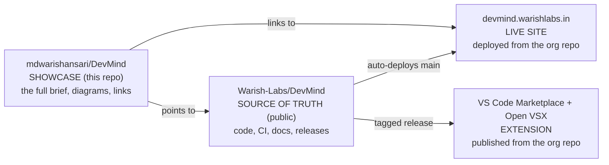

| Repository | Role | Why it is separate |
|---|---|---|
| `mdwarishansari/DevMind` | Personal showcase and the single most detailed project brief (this file) | Portfolio visibility; the same pattern as the ForgeFlow-AI project |
| `Warish-Labs/DevMind` | The real project: code, CI, ADRs, deployments | Public so that free-tier hosting, rulesets, secret scanning and unlimited CI minutes all work; deployed and managed under the WarishLabs account |

**Ownership:** DevMind is designed, built and owned by **MD Warish Ansari (`@mdwarishansari`)** under the **WarishLabs** brand. Issues and pull requests belong in the source repository.

---

## 3. The problem

> *Software projects don't become difficult because developers can't write code. They become difficult because a real project creates hundreds of connected problems across development, security, bugs, documentation, reviews and deployment, and these are usually handled as separate, disconnected activities.* (DevMind vision)

A working developer constantly asks questions that today have no single home:

| Question in the developer's head | Where they currently go |
|---|---|
| What does this codebase actually do? | Read files by hand, ask a teammate |
| Is this endpoint actually protected? | Trace the auth logic manually |
| Have I hit this bug before? | Memory, old chats, searching again |
| Did this change make the docs wrong? | Nobody checks until someone notices |
| Is this pull request safe to merge? | A tired reviewer, skimming |
| Why does it work locally but not in production? | Logs, guesswork, trial and error |
| What should I work on next? | Gut feeling |
| Is this project actually ready to ship? | Nobody really knows |

None of these is new. What makes them costly is that **they are connected, but tooling treats them as separate.**

### The `/admin/users` story

A developer adds one route:

```ts
router.get("/admin/users", requireAuth, listUsers);   // authenticated... but is it authorized?
```

That single edit is simultaneously:

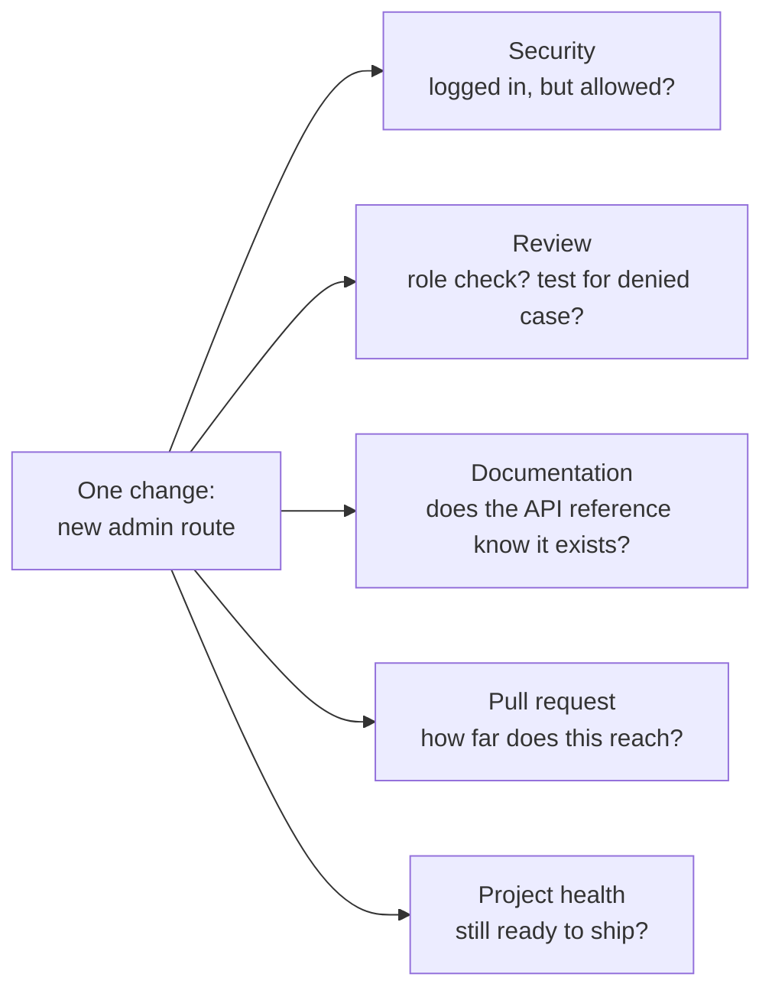

Five questions, usually answered by five different tools, if at all. **DevMind keeps one model of the project, so one change is understood once and used everywhere.**

---

## 4. The solution and core ideas

### 4.1 One shared understanding

Instead of nine disconnected AI utilities, DevMind keeps **one Project Brain** that all agents read from and write to. A finding from the security agent immediately becomes input for review, documentation, pull-request risk and project health.

### 4.2 Two principles that hold it together

| Principle | Meaning |
|---|---|
| **Evidence-based answers, always** | Every finding and answer points at real code with a location, evidence and a confidence. No plausible-sounding text without a source. |
| **Human in the loop** | AI finds, explains and suggests. A person approves fixes, merges, deployments and verdicts. |

### 4.3 Engineering tenets (how the principles are enforced)

| Tenet | How it shows up |
|---|---|
| **Deterministic first, LLM second** | Parsers, scanners, retrieval and scoring produce facts; LLMs explain and reason over facts. The LLM is never the only scanner. |
| **Detect, explain, then (maybe) prove** | Evidence levels E0 to E3 separate "suspected" from "structurally verified" from "reproduced". |
| **Local-first, consent-explicit** | The extension scans locally and uploads only what you approve after a visible preview. |
| **Honest scope** | Language support is declared in tiers; unsupported code is reported as "not analyzed", never as "clean". |
| **Provider-independent AI** | The LLM provider and model are configuration, not code. |
| **Free-tier only** | The whole system is designed to run at no cost (see [section 19](#19-deployment-on-free-tiers)). |

### 4.4 Generic AI assistant vs DevMind

| | Generic AI assistant | DevMind |
|---|---|---|
| Knows the current code | Sometimes, if pasted in | Always, continuously |
| Knows *why* the code is that way | No | Yes, via project history |
| Remembers past bugs in this project | No | Yes |
| Knows what changed recently, and why | No | Yes |
| Connects a change to its downstream risk | No | Yes (change-impact analysis) |
| Improves its understanding over time | No | Yes, the Project Brain compounds |

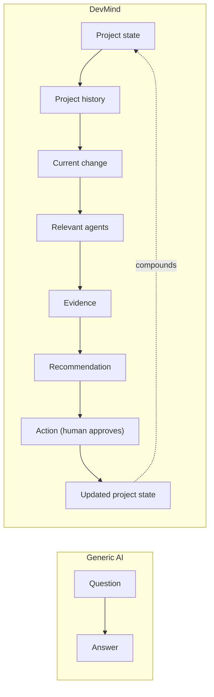

> The generic assistant answers a question. **DevMind carries the project forward.**

---

## 5. Vision, users and use cases

**Vision.** Every software project has a teammate that remembers its code, its history and its risks.

**Mission.** Remove the disconnection between development, security, bugs, documentation, review and deployment by giving all of them one shared, evidence-backed understanding.

### Who it is for

| Persona | Context | What they need most |
|---|---|---|
| **Solo / student developer** (initial focus) | Builds full-stack apps alone; limited review and QA | Understand own code later, catch auth gaps, know what to do next, know if it is shippable |
| **Small-team developer** | PR-based workflow, 2 to 8 people | Consistent review, PR impact, documentation freshness |
| **New contributor** | Joins an unfamiliar codebase | "Where is X enforced?" answered fast |
| **Tech lead / reviewer** | Owns quality and releases | Release readiness with reasons |
| **Workspace admin** | Manages members and data policy | Control of consent, retention and providers |

### Jobs to be done

1. When I open an unfamiliar codebase, I want to ask how a flow works and get an answer grounded in real files.
2. When I add or change a route, I want to know whether it is **authorized**, not just authenticated.
3. When a bug resembles an old one, I want the earlier cause and fix surfaced.
4. When code changes, I want to know which docs became wrong.
5. When I open a PR, I want its blast radius and risks summarised before merge.
6. When a deployment fails, I want the probable root cause and next step, not just logs.
7. When I do not know what to do next, I want a dependency-aware recommendation.
8. When I consider a release, I want an honest readiness verdict with reasons.

### What DevMind is **not**

- Not a general AI coding assistant, and **no chat inside VS Code** in version one.
- Not an auto-fixer: it never applies fixes, merges or deploys by itself.
- Not a vulnerability guarantee: it detects possible weaknesses and says how sure it is.
- Not executing untrusted repository code.
- Not paid software: no billing, no paid dependencies (usage accounting and quotas exist to prevent runaway cost).

---

## 6. The nine capabilities

All nine run on the same Project Brain. Each has a named agent.

| ID | Capability | Agent | The question it answers | Release |
|---|---|---|---|---|
| **CAP-01** | Code Intelligence | CodeMate | *How does this project work?* | **MVP** |
| **CAP-02** | Security Intelligence | AuthCheck | *Is this endpoint allowed to do that?* | **MVP** |
| **CAP-03** | Bug Memory | BugMemory | *Have we fixed something like this before?* | 1.2 |
| **CAP-04** | Living Documentation | DocsAlive | *Is the documentation still true?* | 1.2 |
| **CAP-05** | Code Review Intelligence | ReviewBuddy | *Would a careful reviewer approve this?* | 1.1 |
| **CAP-06** | Pull Request Intelligence | PRAgent | *What does this pull request touch?* | 1.1 |
| **CAP-07** | Deployment Diagnosis | DeployDoctor | *Why did the deploy fail?* | 1.4 |
| **CAP-08** | Project Mentor | ProjectMentor | *What should I work on next?* | 1.3 |
| **CAP-09** | Project Evaluation | ProjectEvaluator | *Is this ready to ship?* | 1.3 |

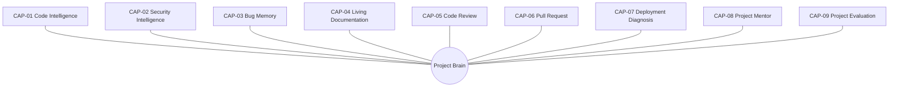

<details>
<summary><b>Capability details (purpose, inputs, outputs, behavior)</b> (click to expand)</summary>

### CAP-01 Code Intelligence (CodeMate) · MVP
- **Purpose:** answer plain-language questions about the project, grounded in real code.
- **Inputs:** the question, the project, the current snapshot, the Project Brain (index, symbols, relationships).
- **Outputs:** an answer with **citations** (file path, line range, snapshot); optional per-function summary (purpose, inputs, outputs, edge cases).
- **Behavior:** retrieval is deterministic; the LLM generates the answer; a deterministic check verifies every citation exists. If nothing relevant is found it says **"insufficient evidence"** instead of guessing.

### CAP-02 Security Intelligence (AuthCheck) · MVP, authentication and authorization first
- **Purpose:** close the gap between "logged in" and "allowed to". Detect missing or weak guards on routes.
- **Inputs:** extracted routes, handlers, middleware, guards, role checks; deterministic rule hits; retrieved context.
- **Outputs:** findings with title, location, why it matters, severity, confidence, **evidence level**, suggested remediation (text only).
- **Behavior:** detection is deterministic (rule engine, structural verifier); the LLM only explains evidence it is given. Unsupported frameworks are reported as **not analyzed**.

### CAP-03 Bug Memory (BugMemory) · 1.2
Remembers resolved issues (error signature, cause, fix, files) and matches new errors against history, with a similarity explanation. Starts project-scoped.

### CAP-04 Living Documentation (DocsAlive) · 1.2
Detects **documentation drift** (new endpoint without a doc entry, stale README section) by diffing routes and symbols against doc references, then drafts patch proposals that a human approves.

### CAP-05 Code Review Intelligence (ReviewBuddy) · 1.1
Checklist review (validation, error handling, authorization, tests, documentation) against configurable project **review rules**, producing findings in the same evidence-backed format.

### CAP-06 Pull Request Intelligence (PRAgent) · 1.1
Summarises a PR with **change-impact analysis**: purpose, affected areas (via the relationship model), risks, security findings, testing concerns, documentation impact. Fans out to AuthCheck, ReviewBuddy and DocsAlive in parallel.

### CAP-07 Deployment Diagnosis (DeployDoctor) · 1.4
From pasted or uploaded logs plus recent changes and config files, ranks probable root causes with **quoted log lines** as evidence and matches past incidents via Bug Memory. No live log access in v1.

### CAP-08 Project Mentor (ProjectMentor) · 1.3
Recommends the next task using dependencies, severity and goals. The ranking is deterministic (never above an unmet prerequisite); the LLM only explains it.

### CAP-09 Project Evaluation (ProjectEvaluator) · 1.3
A health picture and a **release-readiness verdict** with listed blockers. Scores come from a deterministic rubric; the LLM narrates. The MVP overview shows only what is real (security score and analysis coverage); other categories show **"not assessed"** rather than invented numbers.

</details>

### Release plan

| Release | Capabilities |
|---|---|
| **MVP** | CAP-01 Code Intelligence, CAP-02 Security Intelligence (focused), extension, website, Project Brain, privacy controls, quotas |
| **1.1** | GitHub integration, CAP-06 Pull Request Intelligence, CAP-05 Code Review Intelligence, invitations |
| **1.2** | CAP-03 Bug Memory, CAP-04 Living Documentation |
| **1.3** | CAP-08 Project Mentor, CAP-09 Project Evaluation (full health and readiness) |
| **1.4** | CAP-07 Deployment Diagnosis |

> The MVP is **depth on two capabilities** (not shallow versions of all nine) so that every claim stays evidence-backed. The breadth decision is recorded as ADR-038 (open, with this interim default).

---

## 7. One feature, whole lifecycle

DevMind follows a project through **understand, build, review, secure, fix, document, deploy, evaluate, improve**.

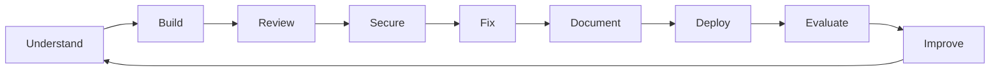

<div align="center">
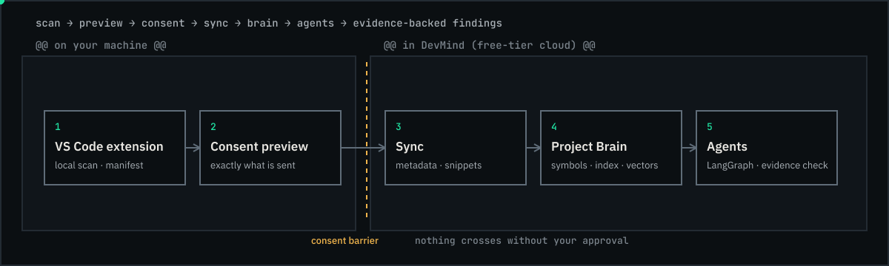
<br><sub>How data moves: nothing crosses the consent barrier without your approval.</sub>
</div>

### The 14-step walkthrough

| # | What happens | Agent | Status in the plan |
|---|---|---|---|
| 1 | Developer writes code: a new admin API is added | (developer) | n/a |
| 2 | Project understanding updates: a new endpoint in the admin module, involving role-based access | Project Brain | MVP |
| 3 | Security check: authentication present, **authorization missing** | AuthCheck | MVP |
| 4 | Code review: missing role validation and no test for the unauthorized case | ReviewBuddy | 1.1 |
| 5 | Pull request summarised: high risk, touches a sensitive admin operation | PRAgent | 1.1 |
| 6 | Documentation gap caught: the new API has no matching documentation | DocsAlive | 1.2 |
| 7 | Developer fixes the gap: authorization added | (developer) | n/a |
| 8 | DevMind re-checks: authorization, testing and documentation now pass | AuthCheck, ReviewBuddy, DocsAlive | MVP (security) |
| 9 | The PR is merged | (human) | n/a |
| 10 | The project deploys | (CI/CD) | n/a |
| 11 | Deployment fails in production | (production) | n/a |
| 12 | DeployDoctor investigates; Bug Memory surfaces a similar past incident | DeployDoctor, BugMemory | 1.4 / 1.2 |
| 13 | Developer applies the known fix | (developer) | n/a |
| 14 | Project Evaluation updates: security, deployment health and overall health improve | ProjectEvaluator | 1.3 |

> The point of the system: **support the whole lifecycle, not one isolated moment in it.**

### The dashboard: five questions, one screen

| Question | Answered by |
|---|---|
| What is happening? | Current project activity, scans and jobs |
| What is broken? | Open bugs and critical issues |
| What is risky? | Security and review findings |
| What should I do next? | ProjectMentor's recommendation (until it ships, the overview shows a clearly labelled rule-based "highest-priority finding") |
| Is the project healthy? | Overall health and release readiness (MVP: security score and analysis coverage; the rest "not assessed") |

---

## 8. The Project Brain

The Project Brain is **not** one giant prompt and **not** a pile of raw files. It is a **structured, version-aware model** of the project made of ten related but different parts.

<div align="center">
<br><sub>The ten layers (animated). Only layer 01 lives on your machine.</sub>
</div>

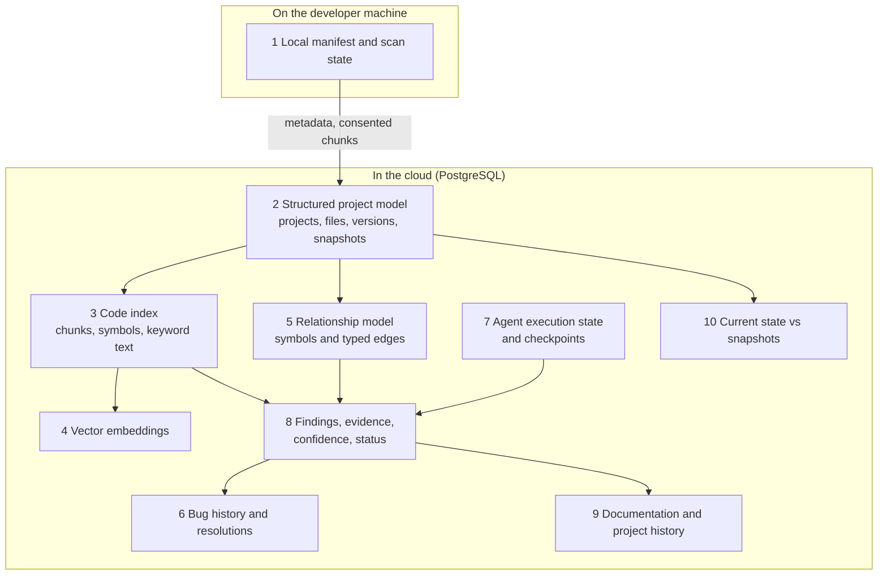

| # | Layer | What it is | What it is **not** |
|---|---|---|---|
| 1 | Local manifest and scan state | File list with hashes, sizes, languages, parse status, local findings | A copy of your code in the cloud |
| 2 | Structured project model | Projects, files, file versions, project snapshots | A vector store |
| 3 | Code index | Chunks, symbols, identifier-split keyword text | The only way to retrieve |
| 4 | Vector embeddings | Semantic meaning of chunks (pgvector), versioned by embedding space | A substitute for the code index |
| 5 | Relationship model | Calls, imports, guards, defines-route edges between symbols | Something that needs a graph database (it lives in PostgreSQL tables) |
| 6 | Bug history | Errors, causes, fixes, files touched | Chat logs |
| 7 | Agent execution state | Workflow checkpoints that hold references, not code | A place to store source |
| 8 | Findings and evidence | What, where, why, evidence level, status history | Free-text opinions |
| 9 | Documentation and history | Doc records, drift items, project timeline | An editor |
| 10 | Current state vs snapshots | What is true **now** versus what was true at a past commit or scan | An overwrite of history |

### How the Brain stays correct

- **Version-aware:** every file version has a content hash; every scan produces a **project snapshot**; "current" is a pointer to the latest snapshot.
- **Staleness:** when a file changes, derived chunks, symbols, relationships and findings tied to the old version are marked **stale** and re-verified; they are never silently trusted. A finding whose evidence file changed moves to `stale`, then back to `open` or on to `resolved` after re-verification.
- **Incremental:** only changed files (by hash) are re-sent, re-parsed and re-embedded.
- **Deletion:** removing consent or deleting a project purges database rows, embeddings, checkpoints and objects, with per-store counts recorded.

### Hybrid retrieval (keyword + vector + symbols + relationships)

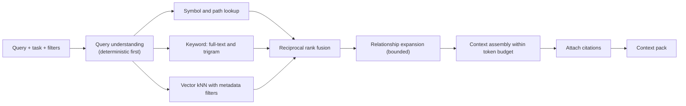

| Retrieval signal | Good at | Misses |
|---|---|---|
| Syntactic (AST, symbols) | Exact facts: "where is `requireRole` defined?" | Meaning |
| Keyword (full-text, trigram) | Identifiers, error messages | Paraphrases |
| Vector (pgvector) | Concepts: "how is login handled?" | Exact names, structure |
| Relationships | "What calls this? What guards this route?" | Content |

Fusion uses **reciprocal rank fusion** (`score(d) = Σ 1 / (k + rank_i(d))`, starting `k = 60`), with constants in configuration and tuned on an evaluation set, not by feel. Every context item carries a citation (`file_version_id`, `path`, `start_line`, `end_line`, `content_hash`, `symbol_key`). The answer may cite **only** from that set, and a post-check verifies each citation exists. If relevance is below a floor, DevMind says what is missing instead of generating from weak context.

### One finding, many agents (without running everything every time)

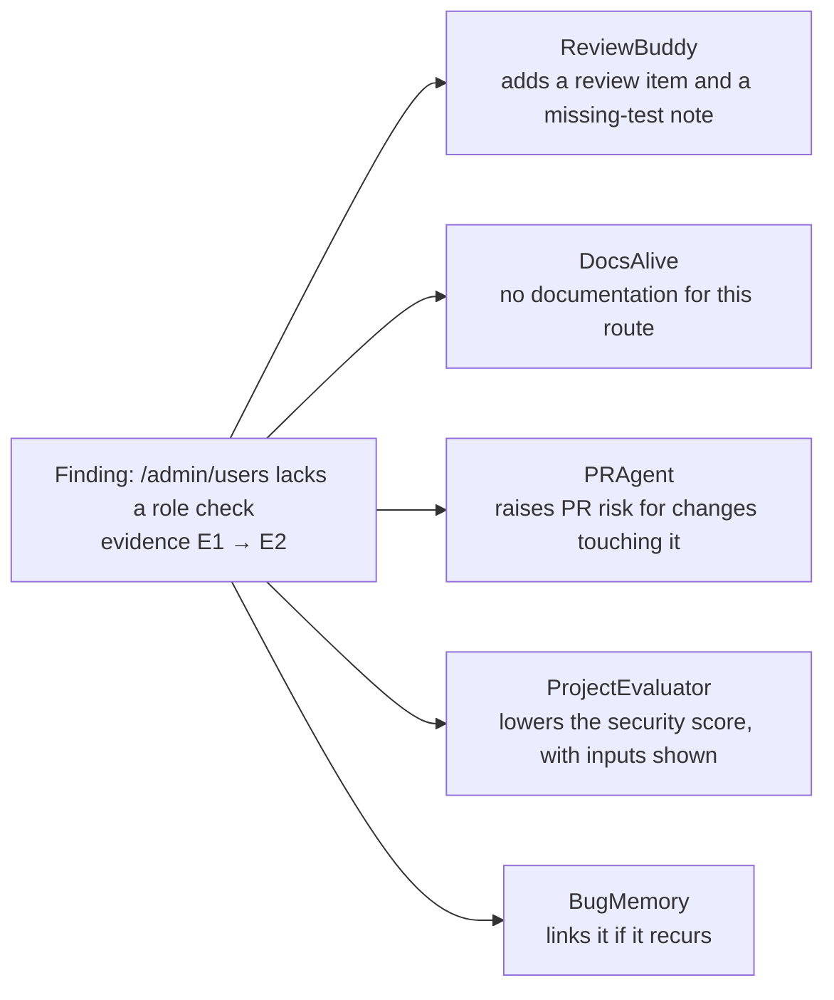

Each agent reads the finding from the Brain and does its own focused work. The whole project is never pushed through every workflow.

---

## 9. Evidence and findings

DevMind separates **detecting a possible weakness** from **proving it exists**.

| Level | Name | Meaning | Where it can come from |
|---|---|---|---|
| **E0** | Suspected | Reasoning only | LLM reasoning (never shown as a defect) |
| **E1** | Pattern match | A deterministic rule hit | Extension or server rule engine |
| **E2** | Structurally verified | Static analysis confirms the condition in the code | Server verifier |
| **E3** | Reproduced | Dynamically demonstrated | **Post-MVP**, needs sandbox design and explicit approval; never emitted in v1 |

**Display rules:** the UI says **"possible"** for E0 and E1 and never "vulnerable". "Verified" means E2 or higher and never means exploit-proven unless E3. Extension-local findings are capped at **E1**.

### What a finding contains

```jsonc
// illustrative shape (see docs/03 for the real schema)
{
  "rule_id": "devmind.authz.missing_role_check",
  "category": "authorization",
  "severity": "high",
  "confidence": "medium",
  "evidence_level": "E1",
  "status": "open",
  "title": "Admin route has authentication but no authorization check",
  "location": { "file": "routes/admin.ts", "start_line": 7, "end_line": 7 },
  "evidence": [
    { "kind": "rule_hit",  "detail": "route /admin/users: guards = [requireAuth]; no role guard" },
    { "kind": "structure", "detail": "handler listUsers: no role check in body" }
  ],
  "suggested_remediation": "Add requireRole(\"admin\") or equivalent to this route (proposal only)."
}
```

Every finding must have a **resolvable location and evidence**, or it is not persisted. A stable **fingerprint** (rule + route identity + normalised snippet hash) survives line shifts, so the same finding is tracked across scans.

### Finding lifecycle

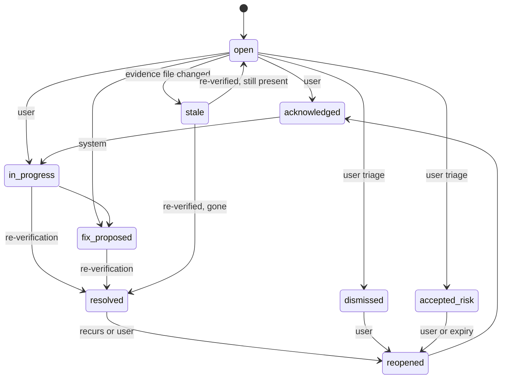

A finding becomes `resolved` only when the system **re-verifies** it against new code, not because someone clicked a button.

---

## 10. System architecture

### 10.1 Context

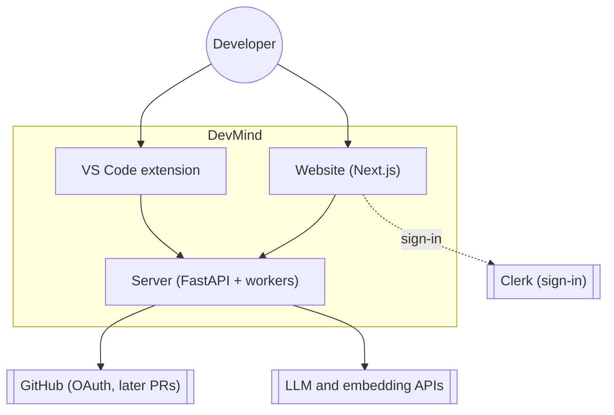

### 10.2 Containers (target topology)

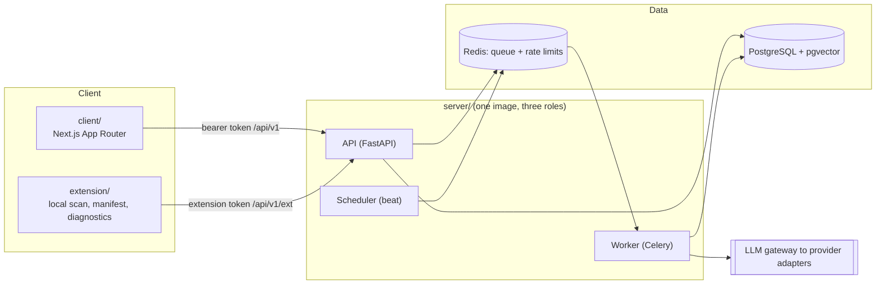

> **Free profile:** the API, an embedded worker and the scheduler run in **one** Render free web service (`DEVMIND_RUN_MODE=all`); the code keeps three separate entry points for a future funded profile. Details in [section 19](#19-deployment-on-free-tiers).

### 10.3 Server layers (modular monolith)

| Layer | Responsibility |
|---|---|
| `api/` | HTTP routers only: validation, auth dependency, mapping errors to RFC 9457. **No business logic.** |
| `core/` | Settings, logging with redaction filter, errors, IDs |
| `domain/` | Services and state machines (finding lifecycle, job lifecycle, scoring) |
| `persistence/` | SQLAlchemy models and repositories. Every function requires an `AuthContext` or an explicit `SystemContext` |
| `brain/` | Ingestion, chunking, indexing, retrieval, snapshots |
| `analysis/` | **Deterministic** analysis: parsers, rules, structural verifier. **Never imports `llm/`.** |
| `llm/` | Gateway, provider adapters, model registry, routing, prompts |
| `orchestration/` | LangGraph graphs and nodes (Agent Manager and specialists) |
| `integrations/` | Clerk, GitHub, email, storage adapters |
| `workers/` | Celery app and tasks |

An **import-boundary checker runs in CI**, so these rules are enforced, not just documented.

### 10.4 The core request flow

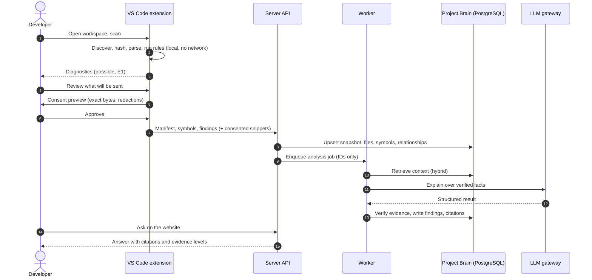

### 10.5 Job lifecycle (asynchronous work)

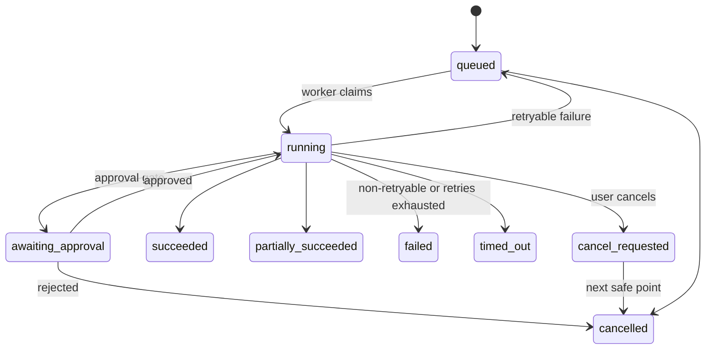

- **PostgreSQL is the source of truth for job state.** Redis only carries job IDs, so losing Redis never loses work (a sweep re-enqueues).
- Jobs are **idempotent** (natural-key upserts), claimed with compare-and-set, tracked with heartbeats, and retried per policy.
- The API returns `202 Accepted` with a job ID; the website follows progress through server-sent events with a polling fallback.

### 10.6 Authentication and authorization

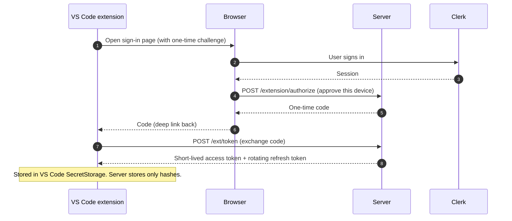

- **Authentication** (who are you?) is Clerk for the website and DevMind-issued, scoped, revocable tokens for the extension.
- **Authorization** (what may you do?) is implemented by DevMind: workspace roles, project roles and a policy service. **Signing in never grants access to every project.** Every route declares its required permission; a route without one fails CI.

---

## 11. Agents and the LLM layer

### 11.1 The Agent Manager

The Agent Manager is the single entry point for agent workflows. It does **not** analyse code itself.

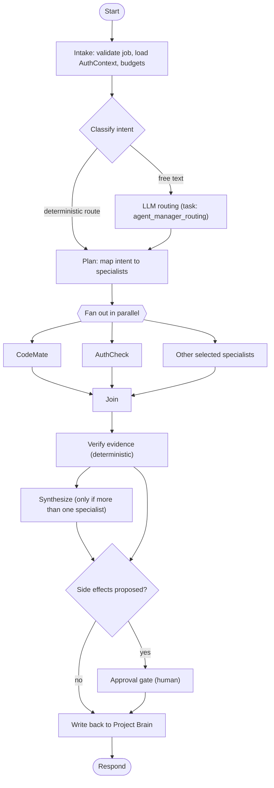

| Intent (examples) | Specialists | Release |
|---|---|---|
| "How does authentication work?" | CodeMate | MVP |
| "Is this endpoint protected?" | AuthCheck | MVP |
| Review a change | ReviewBuddy, AuthCheck | 1.1 |
| Analyze a pull request | PRAgent, then AuthCheck + ReviewBuddy + DocsAlive in parallel | 1.1 |
| "Find bugs similar to this error" | BugMemory | 1.2 |
| Documentation check | DocsAlive | 1.2 |
| "What next?" | ProjectMentor | 1.3 |
| "Is it ready to deploy?" | AuthCheck, ReviewBuddy, BugMemory, DocsAlive, DeployDoctor in parallel, then ProjectEvaluator | 1.3 |
| Deployment failure | DeployDoctor, BugMemory | 1.4 |

Capabilities not yet released are absent from the plan table; asking for them returns a clear **"not available yet"**, never a guess.

### 11.2 What is deterministic, what uses an LLM

| Job | Approach |
|---|---|
| File discovery, hashing, manifest diff | Deterministic |
| Parsing, symbols, relationships, route detection | Deterministic |
| Secret detection, dependency audit | Deterministic scanners |
| Auth/authorization structure on routes | **Deterministic detection, verifier, then LLM explanation** |
| Retrieval, fusion, ranking | Deterministic |
| Answer to a code question | **Retrieval (deterministic), LLM generation, citation check (deterministic)** |
| Bug matching | Deterministic candidates, LLM only to compare and explain |
| Documentation drift | Deterministic diff, LLM drafts patches |
| Task ranking, health scores, readiness verdict | **Deterministic rubric, LLM narrates** |
| CRUD, permissions, quotas, status transitions | Ordinary services (no graph) |

**LangGraph** is used only for the Agent Manager and specialist workflows (multi-step reasoning, branching, tools, checkpoints, approvals). Ingestion, embedding, scanning, scoring, retention and webhooks are **not** graphs. Workflow state holds **references and small values, never code bodies**, so checkpoints stay small and free of source.

### 11.3 The LLM gateway: provider and model are configuration

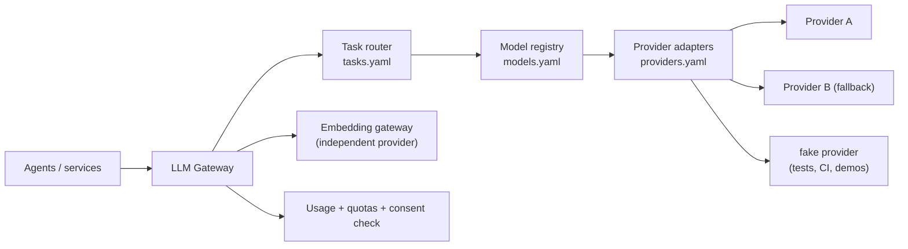

- **Independent choices:** generation provider, embedding provider and model are separately configurable; **no model name is hard-coded** in agents.
- **Task routing:** each task (for example `code_qa`, `security_explain`, `agent_manager_routing`, `final_synthesis`, `embed_code`) maps to a model chain with parameters (temperature, token limits, timeout, retry).
- **Capability validation at startup:** a task that needs structured output or tool calling cannot route to a model not declared to support it. Providers are **not** assumed to be equivalent.
- **Fallback policy:** fall back only on eligible failures (timeouts, rate limits, 5xx), never silently substitute after invalid output (one repair attempt only).
- **Safety:** source-bearing tasks cannot route to a provider flagged `source_code_allowed: false` or with unreviewed terms; keys are never logged; usage and token cost are recorded per call.
- **Fake provider:** deterministic and fault-injecting, so CI never makes live LLM calls.

```yaml
# illustrative shape only. Real model names are an OPEN decision (ADR-017); all values are placeholders.
# server/configs/llm/providers.yaml
providers:
  primary:
    adapter: <adapter-family>
    api_key_env: DEVMIND_LLM_PRIMARY_API_KEY   # the key lives in the environment, never in this file
    terms_reviewed: false
# server/configs/llm/tasks.yaml
tasks:
  code_qa:
    model_chain: [<model-id-primary>, <model-id-fallback>]
    structured_output: false
    max_output_tokens: <n>
```

The **free-tier policy** (ADR-048): the fake provider is the default; free provider tiers may be used only with **synthetic or public code**, because free tiers can use submitted content to improve their products.

---

## 12. The VS Code extension

A **lightweight companion**, not a second web app.

| Does | Does **not** |
|---|---|
| Detect and understand the open workspace | Provide AI chat (version one) |
| Scan supported local files; keep a local manifest | Upload the whole repository silently |
| Detect changes and scan incrementally | Call LLM providers directly |
| Run language-aware, **local** analysis | Execute project code, scripts or tests |
| Show diagnostics, scan status, file references, findings | Open live database connections (deferred; schema info comes from project files) |
| Show project structure and DB info found in schema/model/migration files | Let workspace settings redirect the API URL |
| Let you review and control synchronisation | Send anything without a consent preview |
| Link to the matching project and reports on the website | |

### Local scan pipeline

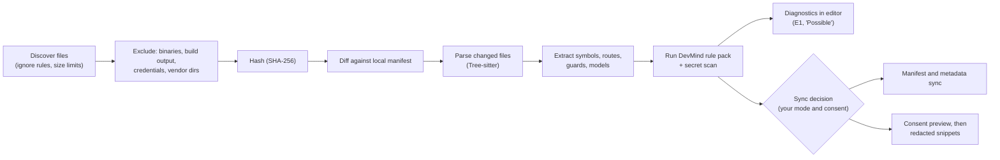

### Sync modes

| | `metadata_only` (default) | `indexed` |
|---|---|---|
| Uploads | Manifest, symbols, relationships, findings **without code** | Plus consented, redacted code chunks |
| Website code questions | Structural answers; you can attach snippets per request | Full retrieval over indexed code |
| Cloud embeddings | None | Chunks embedded |
| Consent | Only per request when snippets are sent | Project-level consent record (provider and data categories) |

Switching `indexed` → `metadata_only` **deletes** stored chunks, embeddings and evidence snippet text (with confirmation).

### What stays where

| Data | Stays local | Stored in DevMind | Embedded | May reach an LLM provider |
|---|---|---|---|---|
| File contents | Always | Only consented chunks (`indexed`) | Only those chunks | Only consented, redacted snippets |
| Absolute paths, machine names | Yes | **Never** | No | No |
| Repo-relative paths, hashes, sizes, languages | Copy | Yes (metadata) | No | May appear as part of facts |
| Symbols and relationships | Copy | Yes | Only inside an embedded chunk header | Possibly as structured facts |
| Credential files, `.env*`, keys | Yes | **Never** | No | **Never** |
| Secrets found inside source | Local | Replaced with `[REDACTED:type:hash]` before leaving | No | No (redacted) |
| Auth tokens | VS Code SecretStorage | Hashes only | No | No |

### The consent preview

Before any source leaves your machine, a preview shows **exactly** which files and line ranges, byte counts, **redactions by type (never values)**, the provider and the purpose, with **Cancel as the default focus**. The preview is hash-bound to the request body, and the server rejects a payload that does not match the previewed hash, so what you approve is what is sent.

### Views

| View | Shows |
|---|---|
| **Findings** | Tree grouped by severity; each item shows `E1 · Possible`, file and line, tooltip with what/why/evidence/rule id |
| **Project structure** | Modules, routes, handlers, guards; missing-role markers |
| **Scan** | Determinate progress, files by support tier, cancel |
| **Sync** | Current mode, last sync, a "what was sent" log |
| **Database (from files)** | Models and schema entities found in project files (labelled as such) |
| Status bar | `idle`, `scanning 12/40`, `offline`, `server waking up…`, `sign-in required`: text, not color alone |

### Language support (honest tiers)

| Tier | Languages | What happens |
|---|---|---|
| **1: semantic** | TypeScript, JavaScript (JSX/TSX), Python | Parsing, symbols, relationships, route and model detection (Next.js, Express, FastAPI; Prisma and SQLAlchemy models), DevMind rule pack, secret scan, dependency audit |
| **2: text-level** | Other common source/config/markup (for example Java, Go, SQL, YAML, Markdown) | Listed in the manifest, text-level chunking when indexed, secret scan; **no security rules** ("not analyzed") |
| **3: unsupported** | Everything else | Hash only |

Support is **never** described as equivalent across languages; the website shows a coverage table so users can see the limits of a clean result.

### Resilience on free hosting

The server may be asleep. A slow first request is shown as **"Server waking up…"** with automatic retries (backoff with jitter), not as a failure. Local scanning is unaffected, and sync queues up while offline.

---

## 13. Data model and API

### 13.1 Entities

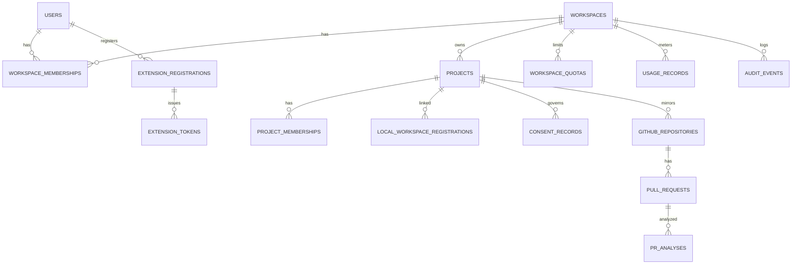

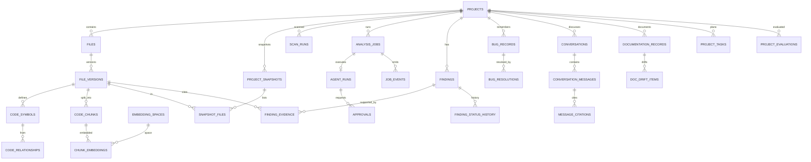

**Design rules:** every tenant-owned table carries `workspace_id`; primary keys are UUIDs (UUIDv7 recommended), timestamps are UTC `timestamptz`; foreign keys have explicit `ON DELETE`; schema changes are Alembic migrations following expand, migrate, contract; code relationships live in ordinary PostgreSQL tables (no graph database, ADR-020); pgvector stores embeddings in **versioned embedding spaces** so the model can change without redesigning the system.

### 13.2 API conventions

| Topic | Convention |
|---|---|
| Style | **REST with an OpenAPI schema** (no GraphQL). Types for the client are generated from OpenAPI |
| Two audiences | Browser: `/api/v1/...` (Clerk bearer token). Extension: `/api/v1/ext/...` (DevMind extension token). A route accepts exactly **one** scheme |
| Errors | RFC 9457 `application/problem+json` with a stable machine-readable `code` (for example `validation.failed`, `consent.required`, `sync.stale_base`, `idempotency.mismatch`, `payload.too_large`, `conflict.state`) |
| Idempotency | Mutating and job-creating calls accept an `Idempotency-Key`; same key and body returns the original result, a different body returns `idempotency.mismatch` |
| Pagination | Cursor-based |
| Rate limiting | Per user, token and workspace, with `429` and `Retry-After` |
| Versioning | Additive changes inside `v1`; breaking changes need `/api/v2` and an ADR |
| Long work | `202 Accepted` with a job ID; `GET /jobs/{id}` and an SSE event stream |

### 13.3 Roles and permissions

| Caller | Project visibility = workspace | Project visibility = private |
|---|---|---|
| Workspace owner or admin | maintainer | maintainer |
| Workspace member | contributor | none unless a project membership exists |
| Workspace viewer | viewer | none unless a project membership exists |
| Explicit project membership | the greater of workspace-derived and project role | the project role |

### 13.4 Endpoint families (browser-facing)

| Family | Examples |
|---|---|
| Auth context | `GET /me` · `GET /me/permissions?project_id=` |
| Workspaces and projects | `GET/POST /workspaces` · `GET/POST /workspaces/{wid}/projects` · `GET/PATCH/DELETE /projects/{pid}` |
| Findings | `GET /projects/{pid}/findings` (filters: status, severity, category, evidence level, file) · `GET /findings/{id}` · `POST /findings/{id}/transitions` |
| Analysis and jobs | `POST /projects/{pid}/analyses` · `GET /jobs/{id}` · `GET /jobs/{id}/events` (SSE) · `POST /jobs/{id}/cancel` · `POST /jobs/{id}/approvals/{approval_id}` |
| Conversations | `GET/POST /projects/{pid}/conversations` · `POST /conversations/{id}/messages` |
| Project Brain | `GET /projects/{pid}/brain/summary` · `/brain/files` · `/brain/symbols` · `POST /brain/search` · `GET /brain/graph?symbol_key=&depth=` · `/brain/snapshots` |
| Reports | `GET /projects/{pid}/evaluations` · `GET /projects/{pid}/release-readiness/latest` |
| Consent and privacy | `GET/POST /projects/{pid}/consents` · `DELETE /consents/{id}` · `PATCH /projects/{pid}/sync-mode` · `POST /projects/{pid}/data-deletion` |
| Usage and audit | `GET /workspaces/{wid}/usage` · `/quotas` · `/audit-events` |
| GitHub (1.1) | OAuth authorize/callback · link repo · pull requests · analyze PR |
| Webhooks | `POST /webhooks/github` · `POST /webhooks/clerk` (signature-verified, no user token) |
| Operations | `GET /healthz` · `GET /readyz` |

### 13.5 Endpoint families (extension-facing, `/api/v1/ext`)

| Family | Examples |
|---|---|
| Session | `POST /ext/token` (exchange code) · `POST /ext/token/refresh` · heartbeat |
| Projects | `GET /ext/projects` · `POST /ext/projects/{pid}/workspaces` |
| Scans | `POST /ext/projects/{pid}/scans` · `PATCH /ext/scans/{id}` |
| Manifest | `POST /ext/projects/{pid}/manifest/diff` · `PUT /ext/projects/{pid}/manifest` (metadata only) |
| Metadata | `PUT …/symbols` · `PUT …/relationships` · `POST …/findings:batch` (no source bodies) |
| Snippets | `POST /ext/projects/{pid}/snippets` (requires a `consent_id`) |

---

## 14. Security, privacy and threat model

DevMind treats security as a feature of the product *and* of how it is built. **It does not promise absolute security**; it documents controls, residual risks and limits.

### 14.1 Trust boundaries

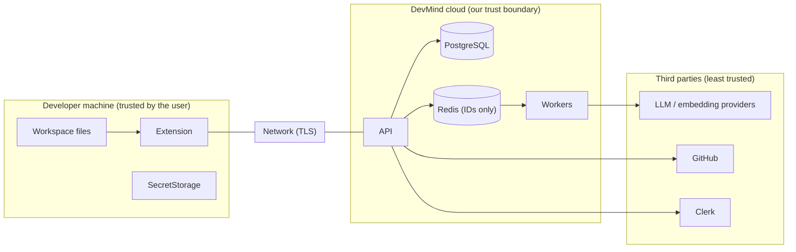

**Repository content is untrusted input** everywhere (code, comments, README, filenames, commit and PR text, logs). It may contain prompt injection. It can never change tool permissions, system instructions or routing, and DevMind **never executes** repository code or installs its dependencies.

### 14.2 Core controls

| Control | How |
|---|---|
| Multi-tenant isolation | Every query scoped by `workspace_id` and `project_id`; vector and keyword search also filter `project_id` and `is_current`; cross-tenant tests for every route; optional PostgreSQL RLS as defense in depth |
| Authorization | One policy service and `AuthContext`; a route without a declared permission fails CI |
| Secret redaction | Path exclusion plus pattern and entropy detection in the extension **and** a server re-check; `[REDACTED:type:hash]` placeholders |
| Consent | Task-specific, recorded consent; hash-bound preview; revocation stops further sends and triggers purge |
| Provider data terms | A provider is flagged `terms_reviewed`; source-bearing tasks cannot route to unreviewed providers |
| Least-privilege tools | Agent tools are allow-listed, read-only by default; writes and external side effects need human approval (single-use, expiring, project-bound) |
| Logging | Structured; **never** logs secrets, tokens, source code, prompts or completions (sizes, hashes, ids, counts only) |
| Webhooks | HMAC signature verification, delivery-ID dedupe, size caps |
| Queue | Authenticated and private; messages carry IDs only; PostgreSQL is the truth |
| Supply chain | Lockfiles, 7-day release-age cooldown, audits, pinned actions, Dependabot, CodeQL |
| Audit | Sensitive actions write audit events with no source content |

### 14.3 Threat model (24 scenarios)

| ID | Asset | Threat | Key mitigation |
|---|---|---|---|
| T-01 | Tenant data | Cross-tenant read/write (IDOR) | `(id, workspace_id)` loading, per-route permission checks, isolation tests |
| T-02 | Extension token | Theft and replay | SecretStorage, short lifetime, rotation, hashing server-side |
| T-03 | Findings integrity | Prompt injection alters findings | Deterministic decisions; injected text cannot suppress a finding |
| T-04 | Secrets | Secret reaches an LLM provider | Path exclusion, pattern and entropy redaction at client and server |
| T-05 | Availability | Hostile file crashes the parser | Size limits, timeouts, worker isolation |
| T-06 | API | SSRF | No user-supplied URL fetching in v1 |
| T-07 | GitHub integration | Forged webhook | HMAC verification, dedupe |
| T-08 | Queue | Redis exposure or poisoning | Auth, private network, ID-only messages |
| T-09 | Host | Execution of untrusted code | Forbidden in v1; E3 requires a sandbox spec |
| T-10 | Browser | XSS via model output | Sanitised rendering, no remote images |
| T-11 | GitHub credentials | Token theft | Envelope encryption, minimal scopes, rotation |
| T-12 | Logs | Sensitive data in logs | Redaction filter, payload logging banned, tests |
| T-13 | Budget | Cost abuse | Quotas, per-job budgets, rate limits |
| T-14 | Supply chain | Malicious dependency | Lockfiles, audit, review of new dependencies |
| T-15 | Auth | JWT validation flaws | Strict issuer/expiry/audience checks, forged-token tests |
| T-16 | Brain integrity | Poisoned client-reported findings | Client findings capped at E1 and re-verified server-side |
| T-17 | Developer machine | Malicious workspace abuses the extension | Machine-scoped settings, no code execution |
| T-18 | Deletion promise | Data persists in backups | Disclose backup window, deletion jobs for live stores |
| T-19 | Provider data | Provider retains or trains on code | `terms_reviewed` gate, per-provider consent, synthetic-only on free tiers |
| T-20 | Evidence | Fabricated or stale citations | Citation resolver and hash check, staleness badges |
| T-21 | Extension supply | Malicious extension update | MFA, CI-only publishing with approval |
| T-22 | Webhook flood | Resource exhaustion | Rate limits, dedupe, per-repo concurrency |
| T-23 | Approvals | Approval bypass | State machine, single-use, expiry, audit |
| T-24 | Redaction preview | Preview differs from payload | `preview_hash` binding, server rejects mismatch |

### 14.4 Retention (proposals, not commitments: ADR-026 is open)

| Data | Proposed default |
|---|---|
| Single-request snippets | Deleted when the job reaches a terminal state plus a short window |
| Indexed chunks and embeddings | Kept while `indexed` consent is active; non-current versions deleted after a configurable window |
| Conversations | Until the user deletes them or the project |
| Job events, agent run records, checkpoints | Limited period; references only |
| Idempotency keys | About 24 hours |
| Usage records and audit events | Long enough for quotas and review; contain no source |

User-initiated deletion and consent revocation create purge jobs across PostgreSQL, Redis and checkpoints with **per-store counts**. Provider backups may retain deleted data for their own window; this is disclosed.

### 14.5 Detecting is not proving

DevMind distinguishes detecting a possible vulnerability from proving it. It does not claim a project is secure, it reports **coverage** ("12 of 40 files analyzed at tier 1"), and an empty result on unsupported code says "not analyzed", never "clean".

---

## 15. Brand, logo and design system

<div align="center">
<picture>
  <source media="(prefers-color-scheme: dark)" srcset="https://raw.githubusercontent.com/Warish-Labs/DevMind/main/brand/svg/devmind-mark-for-dark.svg">
  <source media="(prefers-color-scheme: light)" srcset="https://raw.githubusercontent.com/Warish-Labs/DevMind/main/brand/svg/devmind-mark-for-light.svg">
  
</picture>
&nbsp;&nbsp;&nbsp;

<br><sub>The mark (static and animated: it draws once).</sub>
</div>

### 15.1 What the logo means

The mark is a **D that contains an M**: *Dev* holding *Mind*.

| Part | Meaning |
|---|---|
| **D** (off-white) | The editor pane. Its straight stem is the **line-number gutter**, the same gutter the website layout is built on. The round bowl is also a hemisphere: a mind. |
| **M** (blue graph) | A path of connected nodes shaped like an M: the shared **Project Brain** (code, symbols, bugs, docs, findings linked by relationships). Blue means **connection**. |
| **Center node** (green, with ring) | The **evidence** at the heart of the graph. Every answer and finding points back to something real. Green means **verified, active**. |
| **The dot of the "i"** | The same green node replaces the dot of the *i* in "DevMind", so the wordmark carries the idea too. |

It deliberately avoids generic AI imagery (sparkles, brains, robots, glowing orbs). Square corners, flat fills and a gutter-shaped stem keep it code-native.

<div align="center">

<br><sub>The brand sheet.</sub>
</div>

### 15.2 Palette (color is information, not decoration)

<div align="center">
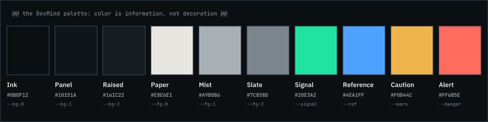
</div>

| Token | Name | Hex | Role |
|---|---|---|---|
| `--bg-0` | Ink | `#0B0F12` | Page background |
| `--bg-1` | Panel | `#10151A` | Panels, sidebars |
| `--bg-2` | Raised | `#161C22` | Inputs, code surfaces |
| `--fg-0` | Paper | `#E8E6E1` | Primary text; logo D |
| `--fg-1` | Mist | `#A9B0B6` | Secondary text |
| `--fg-2` | Slate | `#7C858D` | Metadata (lowest allowed text tone) |
| `--signal` | Signal green | `#20E3A2` | Verified, active, pass; the evidence node |
| `--ref` | Reference blue | `#4EA1FF` | References, links, relationships, focus ring; the M graph |
| `--warn` | Caution amber | `#F0B44C` | Medium severity |
| `--danger` | Alert coral | `#FF6B5E` | Critical and high severity |

Contrast was computed with the WCAG formula: Paper on Ink 15.43:1, Mist 8.77:1, Slate 5.13:1, Signal 11.52:1, Reference 7.21:1, Caution 10.39:1, Alert 6.89:1. Light-background logo variants use deeper blue `#1863C4` and green `#087F59` to keep contrast. Accent colors cover only a small share of any screen.

### 15.3 Design direction

| Aspect | Decision |
|---|---|
| Concept | **Gutter and margin**: the editor's own furniture (line-number gutter, margin notes, diff hunk labels, status bar) is the layout language |
| Typography | **Instrument Serif** (display headlines only), **IBM Plex Sans** (interface), **JetBrains Mono** (code and metadata); self-hosted, open-licensed |
| Shape | 2 px chips, 4 px controls, 6 px panels; hairline borders instead of shadows; no pills, no rounded cards |
| Glass | Allowed in exactly three places (command palette, floating job tray, hover peek cards); everything else is opaque |
| Severity | Never by color alone: glyph + text + color (critical = filled diamond, high = hollow diamond, medium = triangle, low = circle, info = square) |
| Evidence level | Four-segment bar plus text: `E1 · Possible` |

**Anti-template rules** (to avoid a generic AI-generated look): no purple/blue gradients or glowing orbs, no centered headline with three feature cards, no sparkle icons, no fake stats or logos, no unmodified component-kit defaults, no looping decorative motion.

### 15.4 Motion language

| Token | Value | Use |
|---|---|---|
| `--dur-1` | 90 ms | Hover, press, toggle |
| `--dur-2` | 160 ms | Menus, tooltips |
| `--dur-3` | 240 ms | Panels, dialogs, toasts |
| `--dur-4` | 400 ms | Section reveals |
| `--dur-story` | 600 to 1200 ms | Hero sequence and walkthrough only |
| Easing | `cubic-bezier(0.2, 0, 0, 1)` (out), `(0.4, 0, 1, 1)` (in) | No bounce or overshoot |

Only `transform`, `opacity` and drawn strokes animate. Motion explains cause and effect; it never decorates and never blocks. **Reduced-motion** shows final states immediately and removes scroll-linked effects. There is **no scroll-jacking**.

### 15.5 Accessibility (WCAG 2.2 AA target)

Visible 2 px focus ring, full keyboard operation, accessible names for every control and code region, semantic tables, polite live regions for job progress, 24 px minimum targets (44 px on touch), works at 200% zoom and 320 px width, no hover-only content. Conformance is claimed only after an audit.

---

## 16. The home page

The public home page (`devmind.warishlabs.in`) is built **first** (phase S1, "screenshot-first") so the project can be shown early. It follows the design above and uses a **single source of truth** for its facts (rule catalog, release status, privacy ledger, capabilities, walkthrough) so the page cannot claim an unshipped capability.

### 16.1 Hero: the Trace

The hero is a real, selectable code pane (not an image) with a margin note attached to line 7. Sequence (about 7 seconds, once, then a fully readable final state):

```mermaid
flowchart LR
  A["Code lines fade in"] --> B["Scan line sweeps the gutter"] --> C["Wavy underline +<br/>gutter glyph on line 7"] --> D["Margin note draws in:<br/>auth ok, authorization missing"] --> E["Evidence bar fills to E1"] --> F["Ripple tags connect:<br/>review, docs, pull request"]
```

```
 7  router.get("/admin/users", requireAuth, listUsers);        @@ /admin/users @@
                                                              Authentication  ✓ required
                                                              Authorization   ✗ missing
                                                              Evidence        ▮▮▯▯ E1 · Possible
```

The animated banner at the top of this README is the same sequence.

### 16.2 The eight sections

| # | Section | Purpose |
|---|---|---|
| 01 | **Hero: the Trace** | State what DevMind does and show it on real-looking code |
| 02 | **One change, five consequences** | Make the problem concrete: security, review, docs, PR, health |
| 03 | **One shared understanding** | The Project Brain as an interactive layered cross-section |
| 04 | **Nine capabilities, one question each** | An index table (not cards) with honest release labels |
| 05 | **Follow one feature** | A pinned scroll timeline of the 14-step walkthrough |
| 06 | **Local first** | Editor and browser diptych with the consent preview, mode toggle |
| 07 | **Privacy ledger** | What stays local, what is stored, embedded, or may reach a provider |
| 08 | **Call to action** | Open DevMind, source link, status line, preferences |

No testimonials, no customer logos, no benchmark numbers, no "trusted by".

### 16.3 The custom cursor (owner decision, ADR-041)

A theme-matched cursor built from the logo's own idea: a small **green core dot** (the evidence node) that tracks the pointer exactly, and a **blue ring** that follows with smoothed lag. The ring expands and attracts slightly over buttons and links, turns into a caret bar over code, and shows a tiny label over hotspots such as "inspect" or "replay". Safeguards: **fine pointers only**, off with reduced motion or via a Preferences toggle, native-cursor fallback, no effect on keyboard focus, one `requestAnimationFrame` loop writing only transforms, paused when idle.

### 16.4 Performance and quality targets (measured, not promised)

LCP at most 2.5 s, INP at most 200 ms, CLS at most 0.1 on a throttled mobile profile; the real numbers are recorded in the project as they are measured.

### 16.5 Screenshots

> Screenshots are generated by the project's `pnpm screenshots` script after each phase and use example data. They will be added here as phases merge.

<!-- When available, replace with:
<table><tr>
<td></td>
<td></td>
</tr></table>
-->

---

## 17. Testing and quality

**Principle:** a claim needs a measurement. "The scanner is reliable" is never written without a labelled fixture set, a metric and a recorded result. CI never makes live LLM calls.

| Layer | Tooling |
|---|---|
| Unit and integration (server) | pytest (+ hypothesis), real PostgreSQL with pgvector and Redis in containers |
| Migrations | Alembic up/down, drift check, seeded upgrade, backward-compatibility |
| Frontend and shared | **Vitest** (not Jest), Testing Library |
| Browser end-to-end | **Playwright** against a local stack with a fake LLM provider |
| Accessibility | Automated checks plus keyboard and screen-reader passes |
| Extension | Unit tests plus VS Code extension-host tests |
| Scanner and retrieval evaluation | Labelled fixtures under `evals/` |
| Static quality | ruff, pyright, ESLint, `tsc --noEmit`, import-boundary checker, secret scan, dependency audit |

### Scanner fixtures: four shapes for every rule

| Class | Meaning | Example (`devmind.authz.missing_role_check`) |
|---|---|---|
| **Vulnerable** | The condition is truly present | Admin route with authentication only |
| **Safe** | Absent, including look-alikes | Role guard applied at router level |
| **Ambiguous** | Cannot be decided statically | Guard injected through runtime configuration |
| **Misconfigured** | Guard exists but is wrong | Role check placed after the response is sent |

Metrics (per rule and overall): precision, recall, false-positive and false-negative rate, and ambiguous-case behavior (ambiguous must yield `E0/E1 possible` or `unknown`, **never E2**). Every false positive or negative found later becomes a new fixture **before** the fix merges.

### Other evaluations

Retrieval (recall@k, MRR, nDCG; fusion ablation; filtered vector search vs exact), citation validity, insufficient-evidence behavior, answer faithfulness, prompt-injection corpus (comments, README, filenames, logs, encoded instructions), failure injection (provider timeouts, 429s, worker kills, Redis outage), and authorization tests (route registry and a cross-tenant matrix).

### Quality gates (a change merges only if all apply)

| Gate | Condition |
|---|---|
| G1 Static | Lint, types, import boundaries, secret scan clean |
| G2 Tests | Unit, integration, migration, frontend, extension suites pass |
| G3 Authorization | Route registry and cross-tenant matrix pass for every new or changed route |
| G4 Contract | OpenAPI unchanged or additive; generated client up to date |
| G5 Scanner | No regression in per-rule metrics; new rules have four-class fixtures |
| G6 Retrieval | No regression beyond tolerance once baselines exist |
| G7 Injection | Corpus passes |
| G8 Docs | Governing documents updated; ADR drafted if a decision changed |
| G9 Security review | Human review for auth, consent, redaction, retention or adapter changes |

One command runs the local checks: **`pnpm test:all`** (fast: lint, types, unit, builds, docs and brand checks) or `pnpm test:all --full` (adds integration, end-to-end, extension-host, evaluations, migrations). It prints a PASS/FAIL/SKIP table and saves logs.

---

## 18. Engineering workflow and CI/CD

### 18.1 Branch to merge

```mermaid
flowchart LR
  M0["main (protected)"] --> BR["feature/* or fix/* branch"]
  BR --> CM["Commit after every task<br/>(Conventional Commits)"]
  CM --> PU["Push + open PR"]
  PU --> CI["CI: ci-gate"]
  CI -->|green| MG["Owner squash-merges"]
  CI -->|red| FX["Fix on the same branch"]
  FX --> CI
  MG --> CL["Merged branch deleted"]
  CL --> M0
  MG --> DEP["Vercel + Render auto-deploy main"]
```

### 18.2 CI pipeline

```mermaid
flowchart TB
  PR["Pull request / push to main"] --> J1["lint-types"]
  PR --> J2["unit"]
  PR --> J3["build"]
  PR --> J4["e2e (Playwright)"]
  PR --> J5["docs + brand drift"]
  PR --> J6["security (audit, secrets, dependency review)"]
  PR --> CQ["CodeQL (separate workflow)"]
  J1 --> G{"ci-gate"}
  J2 --> G
  J3 --> G
  J4 --> G
  J5 --> G
  J6 --> G
  G -->|"all succeeded"| OK["Mergeable"]
```

- **`ci-gate`** is the single required status check; every job runs on every PR (no path filters), so a required check can never go missing.
- **Protecting `main`** has four layers: a repository **ruleset** (PR required, `ci-gate` required, no force-push), a local **pre-push hook**, the **AI agent's own rules**, and a **`main-guard` workflow** that flags any push to `main` that did not come from a PR.
- **Local hooks (Husky):** pre-commit runs lint-staged; commit-msg runs commitlint; pre-push blocks pushes to `main` and runs the fast checks.
- **Dependencies:** pnpm workspaces with a **7-day release-age cooldown**, blocked exotic sub-dependencies and no-downgrade trust policy; `uv` for Python; Dependabot weekly and grouped; actions pinned by commit SHA.
- **Extension release:** a tag like `ext-v0.1.0` builds, tests and packages the `.vsix`, attaches it to a draft GitHub Release, and publishes (after a manual approval in a protected environment) to the Visual Studio Marketplace and Open VSX.

### 18.3 The AI-agent protocol (how it is built with Antigravity)

The project is built by an AI coding agent working under rules and a memory it can recover after any interruption.

| File | Purpose |
|---|---|
| `AGENTS.md` and `.agents/rules/` | Operating rules: architecture constraints, security, free-tier only, public-repo hygiene, human-approval boundaries |
| `PLAN.md` | The single master checklist of every task, in order, with branch names, acceptance checks and status (`[ ]` todo, `[~]` in progress, `[x]` done and verified, `[!]` blocked) |
| `BRAIN.md` | The agent's working memory: current state, exact next action, what it did and how, verified commands, gotchas, versions |
| `docs/ANTIGRAVITY_PROMPT.md` | The master prompt: phases, workflow, specifications |

The owner types only **`continue`**: the agent reads `BRAIN.md` and `PLAN.md`, checks git and PR state, runs the after-merge routine if a PR merged, and resumes the next task. Rules: inspect before editing, small reviewable changes, report **real** command output, disclose deviations, never claim tests passed without running them, never push to `main`, and stop for human approval on deployments, migrations, security changes and anything with external side effects.

---

## 19. Deployment on free tiers

DevMind is designed so that **nothing costs money** (ADR-046).

```mermaid
flowchart LR
  subgraph Dev["Developer"]
    EXT["VS Code extension"]
  end
  subgraph V["Vercel Hobby"]
    WEB["client/ (Next.js)<br/>devmind.warishlabs.in"]
  end
  subgraph R["Render (free)"]
    SVC["ONE web service: API + embedded worker + scheduler<br/>api.devmind.warishlabs.in"]
    KV[("Key Value (free)<br/>queue, rate limits")]
  end
  NEON[("Neon Free<br/>PostgreSQL + pgvector")]
  CK[["Clerk (free)"]]
  AI[["LLM + embedding APIs<br/>(free tier or fake provider)"]]
  EXT -->|"extension token"| SVC
  WEB -->|"bearer token"| SVC
  WEB -. sign-in .-> CK
  SVC --> NEON
  SVC --> KV
  SVC --> AI
```

| Layer | Service | Free-tier facts to plan around (checked 2026-10-13; re-verify when relying on them) |
|---|---|---|
| Website | **Vercel Hobby** | Personal, **non-commercial** use; deploys organization repositories only if public; commit author must be the team owner |
| API + worker + scheduler | **One Render free web service** (Docker) | 512 MB RAM; **sleeps after about 15 minutes idle** and takes about a minute to wake; 750 free instance hours per workspace shared with other free services; **no free background-worker service**, so the Celery worker is embedded (`DEVMIND_RUN_MODE=all`) |
| Queue and rate limits | **Render Key Value (free)** | 25 MB, no persistence, one per workspace; treated as **disposable**, because PostgreSQL holds job state |
| Database | **Neon Free** | Small per-project storage cap (plan for 0.5 GB), compute suspends after about 5 minutes idle; pgvector available |
| Sign-in | **Clerk (free)** | Generous monthly-active-user allowance; custom domain supported |
| AI | **Fake provider by default**; a free tier (for example Google AI Studio) only with **synthetic or public code** | Rate-limited; free tiers can use submitted content to improve products |
| Email (later) | **Resend** on the verified `warishlabs.in` domain | Free tier send limits |
| CI/CD | **GitHub Actions**, public repo | Unlimited standard-runner minutes |
| Extension | **VS Code Marketplace** and **Open VSX** | Free to publish |

### Sleep tolerance (designed in)

1. The website and extension treat a slow first request as **"Server waking up…"** with automatic retries, not an error.
2. The database layer retries the first connection after a Neon suspend.
3. On every start the app runs the **job sweep and stale-job reaper**, so jobs stranded by a sleep are resumed or failed with a clear reason.
4. Long jobs are split into short, resumable tasks; the website polls job status.
5. Server-sent events reconnect and fall back to polling.
6. No keep-alive pinger by default (it would burn the shared 750-hour pool).

### Budgets and upgrade triggers

- **Memory:** the combined container is measured against the 512 MB limit; if it does not fit, the fallback is a Postgres-backed job runner (needs its own decision record).
- **Storage:** embedding dimension at most 768 (or half-precision vectors); per-project limits are derived from measured bytes per chunk, never guessed.
- **Upgrade triggers (not now):** always-on worker needed, memory exceeded, storage cap hit, commercial use, or a free tier changes its terms.

### Domains and configuration

`devmind.warishlabs.in` (client) and `api.devmind.warishlabs.in` (server) under the verified `warishlabs.in` domain. Configuration is environment variables only (names such as `DEVMIND_ENV`, `DEVMIND_RUN_MODE`, `DEVMIND_DATABASE_URL`, `DEVMIND_REDIS_URL`, `DEVMIND_CLERK_ISSUER`, `DEVMIND_CORS_ORIGINS`; client `NEXT_PUBLIC_API_BASE_URL`, `NEXT_PUBLIC_CLERK_PUBLISHABLE_KEY`), with placeholders in `.env.example` files. **The repository is public: no real value is ever committed.** Migrations run at container start under a database advisory lock; a rollback means redeploying the previous successful deploy.

---

## 20. Roadmap and current status

### 20.1 Status today (16 October 2026, from the project's `BRAIN.md` and file tree)

| Area | State |
|---|---|
| Product and architecture specification (docs 00 to 13, 49 ADRs) | **Written** and merged |
| Brand kit (logo, icons, social images, tokens, brand sheet) | **Done** |
| Phase P0: layout, ADRs, agent rules, runbooks, docs link checker | **Done** (PR #1 merged) |
| Phase P0: tooling (pnpm workspaces, shared `common` package with data schemas, Husky/commitlint hooks, `test-all` runner, brand sync) | **Done** |
| Phase P0: GitHub and CI (`ci-gate`, CodeQL, `main-guard`, PR-title check, release workflow, Dependabot, templates) | **Done** |
| Phase S1 (home page): Next.js app, tokens, fonts, brand sync, shared data sources, layout (header, gutter rail, footer), `/early-access`, not-found, robots, sitemap, and the **hero Trace** | **Built and merged** |
| Phase S1 (home page): sections 02 to 08, custom cursor and motion system, end-to-end/accessibility/performance checks, screenshots | **In progress** |
| Phase S2 (VS Code extension UI with fixture data) | Planned next |
| Server, Project Brain ingestion, retrieval, LLM gateway, agents (M1 onward) | Planned |
| Last recorded verification | `pnpm verify`: 6 passed, 0 failed, 2 skipped; client tests 8 of 8 passing |

> **Honesty note.** Screenshots and demos use **example/fixture data**. The analysis engine, Project Brain and agents are **specified and scheduled, not yet implemented**. This README describes the design unless it says "built".

### 20.2 Roadmap

```mermaid
flowchart LR
  P0["P0 Foundation<br/>docs, tooling, CI"] --> S1["S1 Home page<br/>(screenshot-first)"]
  S1 --> S2["S2 Extension UI<br/>(fixture data)"]
  S2 --> R1["R1 Showcase README<br/>with screenshots"]
  R1 --> M1["M1 Server foundation"]
  M1 --> M2["M2 Auth, workspaces, projects"]
  M2 --> M3["M3 Real local scanning"]
  M3 --> M4["M4 Brain ingestion"]
  M4 --> M5["M5 Indexed mode,<br/>embeddings, retrieval"]
  M5 --> M6["M6 LLM gateway"]
  M6 --> M7["M7 LangGraph +<br/>CodeMate + AuthCheck"]
  M7 --> M8["M8 Website app"]
  M8 --> M9["M9 Privacy controls,<br/>history, deletion"]
  M9 --> M10["M10 Hardening,<br/>observability"]
  M10 --> M13["M13 Polish +<br/>MVP release"]
  M13 --> V11["1.1 GitHub, PR, Review"]
  V11 --> V12["1.2 to 1.4<br/>Bug Memory, Docs, Mentor,<br/>Evaluation, Deployment Diagnosis"]
```

### 20.3 Milestones

| Milestone | Goal |
|---|---|
| **P0** | A repository where every change is linted, typed, tested, reviewable; CI and rules in place |
| **S1** | A distinctive, accessible public home page, with screenshots |
| **S2** | The extension's real UI (views, diagnostics, status bar, consent preview) driven by fixture data |
| **M1** | Server skeleton, Dockerfile, local compose, free-profile `render.yaml`, launcher (`DEVMIND_RUN_MODE=all`), startup migrations |
| **M2** | Clerk sign-in, workspaces, projects, authorization policy, audit, idempotency, rate limiting, generated API client |
| **M3** | Real local scanning: discovery, manifest, Tree-sitter parsing, route/guard extraction, rule pack, diagnostics; extension sign-in |
| **M4** | Project Brain metadata ingestion: snapshots, files, symbols, relationships, findings with fingerprints, job lifecycle |
| **M5** | `indexed` mode: consent records, hash-bound previews, redaction, chunking, embeddings, hybrid retrieval, evaluation baselines |
| **M6** | LLM gateway: adapters, config validation, routing, fallback, quotas, usage, fake provider |
| **M7** | LangGraph Agent Manager, CodeMate and AuthCheck, evidence verifier, approval gates |
| **M8** | Website: design system, conversation with citations, findings, Brain explorer, job center, usage |
| **M9** | Sync-mode controls, consent management, retention, verifiable deletion, history |
| **M10** | Authorization suite, observability, capacity measurement, runbooks, security review |
| **M13** | Polish, accessibility audit, release readiness: the **MVP release** |
| **M11 (1.1)** | GitHub integration, PRAgent, ReviewBuddy, invitations |
| **M12 (1.2 to 1.4)** | BugMemory and DocsAlive; ProjectMentor and ProjectEvaluator; DeployDoctor |

**Vertical-slice checkpoints:** VS-1 (after M4): scan a fixture, sign in, sync metadata, see structure and findings through the API. VS-2 (after M7): a job answers "how does authentication work?" with resolvable citations and produces an evidence-backed finding. VS-3 (after M8): the same through the website. VS-4 (after M13): the full MVP acceptance criteria.

**No dates are promised.** The order is dependency-driven, and each step must produce something verifiable.

### 20.4 MVP acceptance criteria (the finish line)

1. From an installed extension to the first diagnostic on a TypeScript and a Python fixture, **without the cloud**.
2. With consent, the same project appears on the website with files, symbols, findings and coverage.
3. A question about authentication returns an answer whose **citations resolve to real lines**.
4. A seeded missing-authorization route produces an **E1 "possible"** finding with a visible explanation; a safe route does not.
5. Revoking consent and deleting project data removes cloud records and embeddings (verified by test).
6. A user in workspace A **cannot** read workspace B's data through any endpoint (automated suite).
7. Provider failure triggers the documented fallback or a clear error, never silent model substitution.

---

## 21. Technology stack

| Layer | Technology | Why | Status |
|---|---|---|---|
| Website | **Next.js** (App Router), **TypeScript** strict, Tailwind with design tokens | Static home page, authenticated app shell, typed end to end; deployed separately | Confirmed |
| Shared code | `common/` TypeScript package (`@devmind/common`): data schemas, tokens, generated API client | One source of truth for the website, extension and tests | Confirmed (owner) |
| Extension | TypeScript on the VS Code extension API, Tree-sitter (WASM) for parsing | Local-first scanning in the editor | Confirmed |
| API | **FastAPI** (Python), Pydantic v2, modular monolith | Typed, async, OpenAPI for free | Confirmed |
| Persistence | SQLAlchemy 2, Alembic, psycopg 3 | Mature typed ORM and migrations | Recommended |
| Background work | **Celery** workers + scheduler (beat) on **Redis** | Mature retries, schedules; PostgreSQL stays the source of truth | Celery recommended, Redis confirmed |
| Agents | **LangGraph** (agent workflows only) | Branching, checkpoints, approvals | Confirmed |
| Database | **PostgreSQL + pgvector** (Neon), `pg_trgm`, full-text search | One system for relational data, keywords and vectors; no graph or separate vector DB | Confirmed |
| Auth | **Clerk** for web sign-in; DevMind-issued tokens for the extension; authorization by DevMind | Do not build password handling; keep permissions in one place | Confirmed |
| AI | Provider-agnostic gateway; hosted LLM and embedding APIs; fake provider for tests | No lock-in, no live calls in CI | Architecture confirmed; models **open** |
| Hosting | **Vercel Hobby**, **Render free**, **Neon Free** | Free-only constraint | Confirmed (free profile) |
| Object storage | Cloudflare R2 (only if ever needed) | Not required for the MVP | Deferred |
| Email | Resend on `warishlabs.in` | Invitations (M11) | Deferred |
| Tooling | pnpm workspaces, `uv`, Docker, Husky, lint-staged, commitlint | Reproducible, supply-chain-aware | Confirmed (owner) |
| Testing | Vitest, Playwright, pytest, hypothesis | Fast, modern, Jest-compatible API | Confirmed (owner) |
| CI/CD | GitHub Actions (`ci-gate`), CodeQL, Dependabot; Vercel and Render auto-deploy | Free on public repos | Confirmed |
| Build agent | Google Antigravity with `AGENTS.md`, `PLAN.md`, `BRAIN.md` | Structured, recoverable AI-assisted development | Owner choice |

---

## 22. Architecture decisions

**49 decision records** (ADR-001 to ADR-049) are kept in [docs/12](https://github.com/Warish-Labs/DevMind/blob/main/docs/12-architecture-decisions-and-open-questions.md), each with context, decision, rationale, alternatives, trade-offs, consequences and "when to revisit". Status words: **Confirmed** (fixed by the owner), **Recommended** (a default awaiting validation), **Deferred** (deliberately later), **Open** (needs research or an experiment).

<details>
<summary><b>All 49 decisions</b> (click to expand)</summary>

| ADR | Decision | Status |
|---|---|---|
| ADR-001 | Website is the primary application; VS Code extension is a lightweight companion | Confirmed |
| ADR-002 | Frontend: Next.js + TypeScript, deployed separately from the backend | Confirmed |
| ADR-003 | Frontend rendering, data-fetching and styling strategy | Recommended |
| ADR-004 | Backend: Python + FastAPI modular monolith, Dockerized, on Render | Confirmed |
| ADR-005 | API service and worker service are separate deployables sharing one codebase | Confirmed |
| ADR-006 | LangGraph for agent workflows only; ordinary services for CRUD and deterministic work | Confirmed |
| ADR-007 | PostgreSQL (Neon) with pgvector as the system of record | Confirmed |
| ADR-008 | Redis-backed asynchronous job queue on managed, persistent Redis | Confirmed |
| ADR-009 | Celery as the initial worker implementation | Recommended |
| ADR-010 | Clerk for web authentication; authorization is implemented by DevMind | Confirmed |
| ADR-011 | DevMind-owned workspaces and memberships rather than Clerk Organizations | Recommended |
| ADR-012 | Extension authentication through DevMind-issued, scoped, revocable tokens | Recommended |
| ADR-013 | Cloudflare R2 for suitable artifacts only | Confirmed |
| ADR-014 | Resend for transactional email, introduced only when a feature needs it | Deferred |
| ADR-015 | GitHub: OAuth first, GitHub App evaluated for webhooks and automated PR review | Confirmed (direction) |
| ADR-016 | Provider-adapter LLM layer with configuration-driven routing | Confirmed |
| ADR-017 | Choice of generation provider(s) and exact models | **Open** |
| ADR-018 | Hybrid retrieval inside PostgreSQL (keyword + vector + metadata + symbols) | Confirmed |
| ADR-019 | Hosted embedding API, independent of generation provider; versioned embedding spaces | Confirmed (approach) / Recommended (mechanics) |
| ADR-020 | Code relationships stored in PostgreSQL tables; no graph database | Recommended |
| ADR-021 | Local-first scanning with selective cloud synchronization | Confirmed |
| ADR-022 | Two project sync modes: `metadata_only` and `indexed` | Recommended |
| ADR-023 | Static analysis stack; TypeScript/JavaScript and Python as first-class languages | Confirmed (languages) / Recommended (tools) |
| ADR-024 | Evidence levels E0–E3 and a mandatory verification step for findings | Recommended |
| ADR-025 | Tenant isolation by application-layer authorization, with optional RLS as defense in depth | Recommended |
| ADR-026 | Default data-retention periods | **Open** |
| ADR-027 | Model routing and fallback policy | Recommended |
| ADR-028 | Prompts are versioned files in the repository | Recommended |
| ADR-029 | Billing deferred; usage accounting and quotas included from the start | Confirmed |
| ADR-030 | Observability: structured logs, OpenTelemetry, error monitoring | Recommended (vendor Open) |
| ADR-031 | Managed Redis provider | **Open** |
| ADR-032 | Frontend hosting | Recommended |
| ADR-033 | Local manifest store technology in the extension | **Open** |
| ADR-034 | Live database connectivity from the extension | Deferred |
| ADR-035 | UI visual direction | Confirmed (direction) / Recommended (tokens) |
| ADR-036 | Python and TypeScript engineering toolchain | Recommended |
| ADR-037 | LangGraph checkpointing in PostgreSQL | Recommended |
| ADR-038 | MVP scope and breadth | **Open** (interim default stated) |
| ADR-039 | Repository folder names `client/`, `server/`, `extension/`, `common/` | Confirmed (owner, 2026-10-13) |
| ADR-040 | Screenshot-first build order (home page and extension shell before M1) | Confirmed (owner) |
| ADR-041 | Custom cursor and richer home-page motion (exception to the restraint in 08 §7) | Confirmed (owner) |
| ADR-042 | Tooling: pnpm workspaces for `client`, `extension`, `common`; `uv` for `server`; husky, lint-staged, commitlint; no Turborepo or Nx initially | Confirmed (owner) |
| ADR-043 | Test stack: Vitest, Playwright, pytest; REST/OpenAPI, no GraphQL | Confirmed (owner) |
| ADR-044 | Git workflow: `feature/*` and `fix/*` branches, Conventional Commits, squash merge by the owner, no direct pushes to `main` | Confirmed (owner) |
| ADR-045 | Shared single sources of truth in `common/data/` | Confirmed (owner) |
| ADR-046 | Free-only operating constraint and the **free deployment profile** | Confirmed (owner) |
| ADR-047 | Repository ownership: code in the public `Warish-Labs/DevMind`; personal `mdwarishansari/DevMind` is a showcase redirect | Confirmed (owner) |
| ADR-048 | Free LLM and embedding policy (fake provider by default; free tiers only with synthetic or public data) | Confirmed (owner) |
| ADR-049 | Domain plan under `warishlabs.in` (`devmind.` for the site, `api.devmind.` for the API) | Recommended |

</details>

### Decisions made by the owner during the build

| Decision | Summary |
|---|---|
| ADR-039 | Folders: `client/`, `server/`, `extension/`, `common/` |
| ADR-040 | Screenshot-first: home page and extension UI before the server |
| ADR-041 | Custom cursor and richer motion on the home page, with safeguards |
| ADR-042 | pnpm workspaces for TypeScript, `uv` for Python, Husky hooks, no Turborepo initially |
| ADR-043 | Vitest, Playwright, pytest; REST, no GraphQL |
| ADR-044 | `feature/*` and `fix/*` branches, Conventional Commits, owner squash-merges, no direct pushes to `main` |
| ADR-045 | Shared single sources of truth in `common/data/` |
| ADR-046 | Free-only constraint and the free deployment profile |
| ADR-047 | Real repo is public `Warish-Labs/DevMind`; the personal repo is a showcase |
| ADR-048 | Fake provider by default; free LLM tiers only with synthetic or public data |
| ADR-049 | Domain plan under `warishlabs.in` |

### Open questions (18)

<details>
<summary><b>Everything still undecided, with the interim default</b> (click to expand)</summary>

| ID | Question | Interim default |
|---|---|---|
| OQ-01 | Which generation provider(s) and models? (same as ADR-017) | Placeholders that fail validation |
| OQ-02 | Which embedding model and dimension? | One configurable space; dimension read from config |
| OQ-03 | Retention defaults and provider data terms | Doc 07 §9 proposals; providers flagged `terms_reviewed: false` cannot be enabled in production |
| OQ-04 | Which managed Redis? | Render Key Value |
| OQ-05 | Extension manifest store technology | WASM SQLite |
| OQ-06 | Default sync mode and whether `metadata_only` is useful enough | `metadata_only` default, easy opt-in to `indexed` |
| OQ-07 | Pattern-engine rule licensing and whether to rely only on custom rules | DevMind-authored rules only |
| OQ-08 | Can Clerk alone satisfy extension auth scoping/revocation? | DevMind-issued tokens (ADR-012) |
| OQ-09 | Adopt PostgreSQL RLS, and when? | App-layer authorization first |
| OQ-10 | MVP breadth for the academic demonstration | Depth on two capabilities |
| OQ-11 | When to move from OAuth to a GitHub App | OAuth read-only first |
| OQ-12 | Does the LangGraph PostgreSQL checkpointer work through Neon's pooled endpoint? | Workers use direct connection |
| OQ-13 | Does SSE survive the hosting proxy idle timeouts? | Poll fallback |
| OQ-14 | Frontend host | Vercel |
| OQ-15 | Error-monitoring vendor | Choose before M10 |
| OQ-16 | Font licensing and self-hosting for the chosen typefaces | Self-host, with system fallbacks |
| OQ-17 | Tree-sitter grammar packaging as WASM in the extension; grammar version pinning | Pin versions, load lazily |
| OQ-18 | How is the "Functionality" dimension of project health measured? | Derived from user-declared features and CI results; labeled low-confidence otherwise |

</details>

---

## 23. Risks and honest limits

| Risk | Impact | Mitigation |
|---|---|---|
| Scope: nine agents is a lot for one developer | Nothing ships | Vertical-slice MVP, depth on two capabilities; later agents gated by milestones |
| False positives erode trust | Users ignore findings | Evidence levels, four-class fixtures, per-rule precision tracking, easy dismissal with reason |
| LLM hallucinated claims | Wrong guidance | Deterministic facts first; citation validation; an "insufficient evidence" path |
| Source-code privacy concerns | Adoption blocker | Local-first, consent tiers, redaction, retention controls, free tiers used with synthetic data only |
| Provider terms conflict with the privacy promise | Policy violation | `terms_reviewed` gate before any provider sees source |
| Prompt injection through repository content | Manipulated output or tools | Untrusted-content handling, least-privilege tools, injection test corpus |
| Cost runaway | Unaffordable | Free-only constraint, quotas, routing by task, usage accounting |
| Extension performance | Editor lag | Incremental scanning, off-thread work, measured budgets |
| **Free-tier constraints** | Sleep, 512 MB memory, small database | Sleep-tolerant clients, measured memory budget, storage quotas, upgrade triggers |
| **Vendor terms change** | A free tier disappears or tightens | Vendor facts are re-verified when a milestone relies on them; portable interfaces |
| **Vercel Hobby is non-commercial** | Cannot monetise on Hobby | Move to another free host or pay if DevMind earns money |

**What DevMind does not promise:** absolute security; equal analysis across all languages; that "no findings" means "no problems"; any performance or accuracy figure that has not been measured and recorded; that every capability exists today.

---

## 24. Repository map

### 24.1 Folders (the monorepo, [Warish-Labs/DevMind](https://github.com/Warish-Labs/DevMind))

```text
DevMind/
├── client/            Next.js website (App Router, TypeScript strict)
│   ├── app/             routes: home, /early-access, not-found, robots, sitemap, design tokens
│   ├── components/      hero (Trace, MarginNote), layout (Header, GutterRail, Footer)
│   └── lib/, tests/     data helpers and Vitest tests
├── common/            @devmind/common: shared data (JSON), schemas, tokens, tests
│   └── data/            capabilities, release-status, privacy-ledger, rule-catalog, walkthrough
├── extension/         VS Code companion (media/ now; UI shell next)
├── server/            FastAPI + Celery (Python): created in milestone M1
├── evals/             scanner and retrieval fixtures and results
├── infra/             docker-compose for local development
├── scripts/           test-all, docs-links, sync-brand
├── brand/             logo (svg/png), favicons, social images, tokens, brand guide
├── docs/              specification 00 to 13, runbooks, showcase kit, setup guide, master prompt
├── .github/           workflows (ci, codeql, main-guard, pr-title, release-extension), dependabot, templates
├── .agents/rules/     rules for the AI coding agent
├── AGENTS.md  PLAN.md  BRAIN.md  README.md  CONTRIBUTING.md  SECURITY.md  CHANGELOG.md
└── package.json, pnpm-workspace.yaml, tsconfig*.json, eslint.config.mjs, commitlint.config.mjs
```

### 24.2 Documentation

| Doc | Topic |
|---|---|
| [00](https://github.com/Warish-Labs/DevMind/blob/main/docs/00-documentation-index.md) | Index, precedence rules, reading order |
| [01](https://github.com/Warish-Labs/DevMind/blob/main/docs/01-product-requirements.md) | Product requirements: capabilities, requirements, MVP, non-goals |
| [02](https://github.com/Warish-Labs/DevMind/blob/main/docs/02-system-architecture.md) | System architecture: components, flows, jobs, auth, topology |
| [03](https://github.com/Warish-Labs/DevMind/blob/main/docs/03-data-model-and-api.md) | Data model, state machines, API, error catalog |
| [04](https://github.com/Warish-Labs/DevMind/blob/main/docs/04-project-brain-and-rag.md) | The Project Brain and retrieval |
| [05](https://github.com/Warish-Labs/DevMind/blob/main/docs/05-agents-and-llm-workflows.md) | Agents, LangGraph, LLM gateway and configuration |
| [06](https://github.com/Warish-Labs/DevMind/blob/main/docs/06-vscode-extension-and-local-scanning.md) | The extension, local scanning, sync, consent |
| [07](https://github.com/Warish-Labs/DevMind/blob/main/docs/07-security-privacy-and-threat-model.md) | Security, privacy, threat model |
| [08](https://github.com/Warish-Labs/DevMind/blob/main/docs/08-ui-ux-design-specification.md) | UI/UX, design system, motion, accessibility, logo rules |
| [09](https://github.com/Warish-Labs/DevMind/blob/main/docs/09-testing-and-quality-strategy.md) | Testing, evaluations, quality gates |
| [10](https://github.com/Warish-Labs/DevMind/blob/main/docs/10-deployment-and-operations.md) | Deployment and operations, free profile |
| [11](https://github.com/Warish-Labs/DevMind/blob/main/docs/11-mvp-and-implementation-roadmap.md) | MVP and milestones |
| [12](https://github.com/Warish-Labs/DevMind/blob/main/docs/12-architecture-decisions-and-open-questions.md) | ADRs and open questions |
| [13](https://github.com/Warish-Labs/DevMind/blob/main/docs/13-glossary-and-domain-terminology.md) | Glossary |
| [Setup guide](https://github.com/Warish-Labs/DevMind/blob/main/docs/SETUP-GUIDE.md) | Owner's manual: accounts, keys, GitHub, deploy, publish |
| [Master prompt](https://github.com/Warish-Labs/DevMind/blob/main/docs/ANTIGRAVITY_PROMPT.md) | The build prompt for the AI agent |
| [Brand guide](https://github.com/Warish-Labs/DevMind/blob/main/brand/BRAND-GUIDE.md) | Logo meaning, colors, usage |

---

## 25. Glossary

| Term | Meaning |
|---|---|
| **Project Brain** | The shared, structured, version-aware understanding of one project: ten related layers, not one prompt |
| **Agent Manager** | The single entry point that classifies a request and plans which specialists run; it never analyses code itself |
| **Specialist agent** | A focused workflow (CodeMate, AuthCheck, BugMemory, DocsAlive, ReviewBuddy, PRAgent, DeployDoctor, ProjectMentor, ProjectEvaluator) |
| **Finding** | A reported issue with location, evidence, confidence, severity, evidence level and a lifecycle |
| **Evidence** | The concrete facts supporting a finding or answer (rule hit, structural check, resolvable citation) |
| **Evidence level (E0 to E3)** | Suspected, pattern match, structurally verified, reproduced |
| **Code symbol** | A named code entity (function, class, route, model) identified by a stable `symbol_key` |
| **Code index** | Chunks, symbols and keyword text used for retrieval |
| **Vector embedding** | A numeric representation of a chunk's meaning, stored in pgvector inside a versioned embedding space |
| **Hybrid retrieval** | Combining symbol lookup, keyword search, vector search and relationship expansion with rank fusion |
| **Context pack** | The cited set of retrieved items given to a model for one task |
| **Citation** | A resolvable reference to a file version, path and line range |
| **Bug memory** | Remembered resolved issues used to recognise similar future errors |
| **Scan run** | One execution of the local scan, recorded with its results |
| **Analysis job** | An asynchronous unit of work (analysis, ingestion, report) with a tracked lifecycle |
| **Project snapshot** | The state of a project at one scan or commit; "current" points to the latest |
| **Change-impact analysis** | Using relationships to find what a change can affect |
| **Authentication vs authorization** | Who you are vs what you may do: signing in never grants access to every project |
| **Release readiness** | A verdict on whether the project can ship, with listed reasons and blockers |
| **Local manifest** | The extension's on-machine record of files, hashes and scan state |
| **Sync mode** | `metadata_only` (default) or `indexed`: what the extension may send |
| **Consent record** | A stored, revocable permission naming project, provider and data categories |
| **Cloud synchronization** | Sending approved metadata and snippets to DevMind, incrementally |
| **Model routing** | Config-driven choice of provider and model per task, with fallback |
| **Fixture** | A labelled example (vulnerable, safe, ambiguous, misconfigured) used to measure the scanner |
| **Free profile** | The deployment shape that runs everything on free tiers (ADR-046) |
| **ADR** | Architecture decision record |
| **Slice** | One branch and PR of the build plan, merged by the owner before the next starts |

---

## 26. FAQ

<details><summary><b>Is DevMind just another AI coding assistant?</b></summary>
No. A coding assistant answers a prompt. DevMind keeps a persistent, evidence-backed model of the project and uses it across security, review, documentation, bugs, pull requests, deployment and health. There is also no chat inside VS Code in version one; the extension is a local scanner and companion.
</details>

<details><summary><b>Does my code leave my machine?</b></summary>
Not by default. Scanning is local. In the default `metadata_only` mode only metadata and findings without code are synced. Code snippets leave only after you review an exact preview (files, ranges, byte counts, redactions by type) and approve it, and secrets are redacted first.
</details>

<details><summary><b>Why not just use ChatGPT or Copilot?</b></summary>
They do not carry the project's history, do not track findings over time, do not connect a change to its downstream risk, and do not separate "suspected" from "verified". DevMind is built around those differences.
</details>

<details><summary><b>What are evidence levels for?</b></summary>
To avoid false certainty. A pattern match is "possible" (E1) until static analysis confirms it (E2). Nothing is called "vulnerable" below E2, and E3 (reproduced) is reserved for a later, sandboxed capability.
</details>

<details><summary><b>Can it fix my code automatically?</b></summary>
No. It proposes fixes as text. A human approves anything that matters, and fixes are only marked resolved after the system re-verifies them.
</details>

<details><summary><b>Which languages are supported?</b></summary>
TypeScript/JavaScript and Python get semantic analysis (tier 1), for Next.js, Express and FastAPI routes. Other common languages are listed and text-chunked without security rules (tier 2). Everything else is hashed only. The site reports coverage so a clean result is never misleading.
</details>

<details><summary><b>Why PostgreSQL for everything (no graph or vector database)?</b></summary>
One system covers relational data, keyword search and vectors with pgvector, and code relationships fit ordinary tables. A graph or vector database is only added if measured requirements justify it (ADR-018, ADR-020).
</details>

<details><summary><b>How does it avoid hallucinations?</b></summary>
Facts come from deterministic analysis and retrieval. The LLM explains over that evidence, every claim about code must cite resolvable lines, citations are checked afterwards, and if evidence is missing DevMind says "insufficient evidence".
</details>

<details><summary><b>How does it handle prompt injection from repository content?</b></summary>
Repository text is untrusted. It is delimited in prompts, cannot change instructions or tool permissions, tools are least-privilege with human approval for side effects, and injected text cannot suppress a deterministic finding. A dedicated injection corpus is part of CI.
</details>

<details><summary><b>Is it really free to run?</b></summary>
That is a design constraint: Vercel Hobby, one Render free web service (with the worker embedded), Render's free Key Value, Neon Free, Clerk free, GitHub Actions on a public repo, and a fake LLM provider by default. The trade-offs (sleeping server, 512 MB, small database) are handled explicitly.
</details>

<details><summary><b>Is it finished?</b></summary>
No. See [section 20](#20-roadmap-and-current-status). The specification and brand are complete; the home page is being built; the server, Project Brain and agents are scheduled.
</details>

<details><summary><b>Why two repositories?</b></summary>
`Warish-Labs/DevMind` is the real, public, deployable project. `mdwarishansari/DevMind` (this one) is the personal showcase and the most detailed brief. The same pattern is used for ForgeFlow-AI.
</details>

<details><summary><b>Who built it?</b></summary>
MD Warish Ansari ([@mdwarishansari](https://github.com/mdwarishansari)), solo, under WarishLabs, with an AI coding agent working under the rules and plan described in [section 18.3](#183-the-ai-agent-protocol-how-it-is-built-with-antigravity).
</details>

---

## 27. Pitch kit

### 27.1 Slide outline (about 14 slides)

| Slide | Title | Source section |
|---|---|---|
| 1 | DevMind: know what your code actually allows | Hero, [1](#1-the-short-version) |
| 2 | The problem: connected questions, disconnected tools | [3](#3-the-problem) |
| 3 | One change, five consequences (`/admin/users`) | [3](#3-the-problem) |
| 4 | The idea: one shared Project Brain | [4](#4-the-solution-and-core-ideas), [8](#8-the-project-brain) |
| 5 | Nine capabilities, one question each | [6](#6-the-nine-capabilities) |
| 6 | The lifecycle walkthrough | [7](#7-one-feature-whole-lifecycle) |
| 7 | Evidence, not eloquence (E0 to E3) | [9](#9-evidence-and-findings) |
| 8 | Architecture: website, extension, server, brain | [10](#10-system-architecture) |
| 9 | Agents and the LLM gateway | [11](#11-agents-and-the-llm-layer) |
| 10 | The local-first VS Code extension and consent | [12](#12-the-vs-code-extension) |
| 11 | Security and threat model | [14](#14-security-privacy-and-threat-model) |
| 12 | Design: logo, motion, home page | [15](#15-brand-logo-and-design-system), [16](#16-the-home-page) |
| 13 | Built to run free, built with discipline (CI, tests, workflow) | [17](#17-testing-and-quality), [18](#18-engineering-workflow-and-cicd), [19](#19-deployment-on-free-tiers) |
| 14 | Roadmap, status and what is next | [20](#20-roadmap-and-current-status) |

### 27.2 One-liners

- **10 seconds:** "An AI teammate for your project that remembers your code, shows its evidence, and keeps security, docs, reviews and releases in sync."
- **Tagline:** "Know what your code actually allows."
- **Differentiator:** "Not nine AI tools, nine agents sharing one continuously updated understanding of the project."
- **Trust line:** "It tells you what it knows, how it knows it, and what it is only guessing."

### 27.3 Likely viva questions, short answers

| Question | Answer |
|---|---|
| What is novel here? | The shared, version-aware Project Brain plus evidence levels: agents cooperate on one model, and nothing is presented as proven without verification. |
| Why not rely on the LLM alone? | LLMs hallucinate. Deterministic parsers and scanners produce facts; the LLM explains them; citations and findings are verified. |
| How do you protect privacy? | Local scanning, a default that sends no code, hash-bound consent previews, redaction at client and server, retention and deletion controls. |
| How is it tested? | Labelled fixtures in four classes, precision/recall per rule, retrieval evaluations, injection corpus, authorization matrix, quality gates in CI. |
| Why this stack? | Next.js and FastAPI for typed, separated layers; PostgreSQL with pgvector as one system of record; Celery for retries; LangGraph only where agent workflows need it. |
| What is built today? | Specification, brand, repository and CI foundation, and the home page's foundation and hero; the rest is scheduled with a stated order. |
| How is it deployed for free? | Vercel Hobby for the site; one Render free service running API and worker; Neon Free; sleep-tolerant clients. |
| How do you manage a project this big alone? | A written plan, small slices, CI as the gate, ADRs for decisions, and an AI agent that keeps its own plan and memory. |

### 27.4 Paste-ready context block (to brief any AI about this project)

```text
Project: DevMind. Owner/builder: MD Warish Ansari (@mdwarishansari), under WarishLabs.
Source: https://github.com/Warish-Labs/DevMind   Showcase: https://github.com/mdwarishansari/DevMind   Live: https://devmind.warishlabs.in/
What it is: an agentic AI software engineering system with a shared, version-aware "Project Brain" and nine specialised agents:
Code Intelligence, Security Intelligence, Bug Memory, Living Documentation, Code Review, Pull Request Intelligence,
Deployment Diagnosis, Project Mentor, Project Evaluation. Lifecycle: understand, build, review, secure, fix, document, deploy, evaluate, improve.
Principles: evidence-based findings (levels E0 suspected, E1 pattern match, E2 structurally verified, E3 reproduced; never call E0/E1 "vulnerable"),
deterministic analysis first and LLM reasoning second, human approval for anything sensitive, local-first consent-based privacy.
Interfaces: Next.js website (primary) and a lightweight VS Code extension (local scan, diagnostics, consented sync; no chat).
Stack: Next.js + TypeScript; FastAPI + Celery + Redis; LangGraph (agent workflows only); PostgreSQL + pgvector (Neon); Clerk; hosted LLM/embedding APIs behind a provider-agnostic gateway (models not yet chosen).
Repo folders: client/, server/, extension/, common/ plus docs/, brand/, evals/, infra/, scripts/.
Constraints: free tiers only (Vercel Hobby, one Render free service with embedded worker, Neon Free); public repo, so no secrets ever; REST/OpenAPI, no GraphQL; Vitest/Playwright/pytest.
Status: specification (14 docs, 49 ADRs) and brand done; CI/tooling done; home page foundation and hero built; extension UI, server, brain, agents scheduled (see roadmap).
Rules: do not invent features, results, benchmarks or integrations; describe design as design and status as status.
```

---

## 28. About the builder, license and credits

**MD Warish Ansari** (`@mdwarishansari`): final-year B.Tech Computer Science and Engineering student (2023 to 2027) at RKDF University, Ranchi, India. Solo full-stack developer building web applications, real-time systems and AI-agent projects under **WarishLabs**. Focus areas: Next.js, TypeScript, FastAPI, PostgreSQL, and agentic AI.

| | |
|---|---|
| Personal GitHub | [github.com/mdwarishansari](https://github.com/mdwarishansari) |
| Organization | [github.com/Warish-Labs](https://github.com/Warish-Labs) |
| Website | [warishlabs.in](https://warishlabs.in) |
| This project | [Live](https://devmind.warishlabs.in/) · [Source](https://github.com/Warish-Labs/DevMind) · [Showcase](https://github.com/mdwarishansari/DevMind) |
| Related projects | [ForgeFlow-AI](https://github.com/Warish-Labs/ForgeFlow-AI) · [WarishLabs website](https://github.com/Warish-Labs/warishlabs-website) |

**License.** DevMind is currently **unlicensed (all rights reserved)**. A formal license will be chosen before a public 1.0 (tracked as an open decision). This showcase README and its animated banners are part of the project.

**Credits.** Typefaces: IBM Plex Sans, JetBrains Mono and Instrument Serif (SIL Open Font License). Built with and thanks to: Next.js, React, TypeScript, FastAPI, Pydantic, SQLAlchemy, Celery, Redis, LangGraph, PostgreSQL and pgvector, Tree-sitter, Clerk, Vercel, Render, Neon, GitHub, Playwright, Vitest, and Google Antigravity (the AI coding agent used to build the project).

---

## Appendix: assets and colors

### Files used in this README

| File | Where it lives | Used for |
|---|---|---|
| `assets/hero-trace.svg` | this repo | Animated Trace banner (top of this page) |
| `assets/pipeline.svg` | this repo | Animated data-flow banner (section 7) |
| `assets/brain-strata.svg` | this repo | Animated ten-layer banner (section 8) |
| `assets/palette.svg` | this repo | Palette swatches (section 15) |
| `brand/svg/devmind-lockup-horizontal-for-dark.svg` / `-for-light.svg` | source repo | Header logo (light/dark switching) |
| `brand/svg/devmind-mark-for-dark.svg` / `-for-light.svg` | source repo | The mark (section 15) |
| `brand/svg/devmind-mark-animated.svg` | source repo | Animated mark (draws once) |
| `brand/brand-sheet.png` | source repo | Brand overview (section 15) |

### Other brand files (all in [`brand/`](https://github.com/Warish-Labs/DevMind/tree/main/brand) of the source repo)

| Need | File |
|---|---|
| Stacked logo | `svg/devmind-lockup-stacked-for-dark.svg`, `-for-light.svg` |
| One-color logo | `svg/devmind-mark-mono-white.svg`, `…-mono-black.svg`, `svg/devmind-lockup-horizontal-mono-*.svg` |
| App icon (rounded) | `svg/devmind-icon-dark.svg`, `…-light.svg`; PNG 64 to 1024 in `png/` |
| Favicons and manifest | `favicon/` (ICO, SVG, PNG, Apple touch, Android, maskable, safari pinned tab) |
| Social images | `social/og-image-1200x630.png`, `social/github-social-preview-1280x640.png`, `social/avatar-400.png`, `social/avatar-square-1024.png` |
| VS Code extension | `vscode/icon.png` (128), `icon@2x.png` (256), `activitybar-icon.svg` |
| Design tokens | `tokens/devmind-tokens.css`, `tokens.json`, `tailwind.preset.cjs`, `palette.csv` |
| Wordmark only | `svg/devmind-wordmark-for-dark.svg`, `…-for-light.svg` |

<br>

<div align="center">


**DevMind** · designed, built and owned by [MD Warish Ansari](https://github.com/mdwarishansari) · [WarishLabs](https://warishlabs.in)

[Live site](https://devmind.warishlabs.in/) · [Source code](https://github.com/Warish-Labs/DevMind) · [Back to top](#table-of-contents)

<sub>Specified in public. Built in small, verified steps.</sub>

</div>
